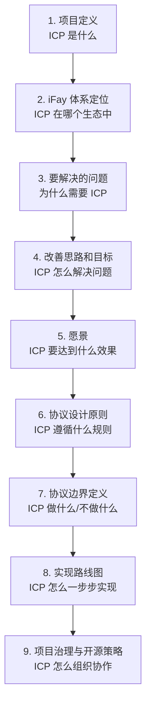

# ICP 蓝图文档设计

## 概述

本设计文档定义 ICP（Interactive Conversation Protocol）蓝图文档（`docs/{lang}/blueprint/overview.md`）的内容结构、章节大纲和写作规范。蓝图文档是 ICP 开源项目的奠基性愿景文档，面向协议的潜在贡献者、使用者、技术评估者和社区成员，阐述项目定位、问题分析、设计原则、协议边界、实现路线图和治理策略。

本设计的目标不是软件实现，而是文档内容的组织和质量保障。设计产出物为一份完整的章节结构定义、各章节内容大纲、写作风格指南，以及用于验证文档质量的正确性属性。

### 设计约束

- 中文（zh-CN）为主语言版本，位于 `docs/zh-CN/blueprint/overview.md`
- 现有内容（项目定义、问题分析、改善思路、中间语言必要性论证、愿景）必须保留
- 新增章节（iFay 体系定位、协议设计原则、协议边界定义、实现路线图、项目治理与开源策略）需与现有内容风格一致
- 文档使用 Markdown 格式，标题层级统一
- 所有抽象概念需配以具体示例或场景说明

### 需求覆盖映射

| 章节 | 状态 | 覆盖需求 |
|---|---|---|
| 1. 项目定义 | 现有（保留） | 需求 1 |
| 2. iFay 体系定位 | **新增** | 需求 2 |
| 3. 要解决的问题 | 现有（保留） | 需求 3 |
| 4. 改善思路和目标 | 现有（保留） | 需求 4 |
| 5. 愿景 | 现有（保留） | 需求 5 |
| 6. 协议设计原则 | **新增** | 需求 6 |
| 7. 协议边界定义 | **新增** | 需求 7 |
| 8. 实现路线图 | **新增** | 需求 8 |
| 9. 项目治理与开源策略 | **新增** | 需求 9 |
| （全文） | 质量要求 | 需求 10 |

## 架构

### 文档整体架构

蓝图文档采用"问题驱动 → 原则约束 → 路线落地"的叙事逻辑，从具体问题出发，经由设计原则和边界约束，最终落地到实现路线图和治理策略。



### 叙事逻辑说明

文档分为三个叙事层次：

1. **定位层**（章节 1-2）：回答"ICP 是什么"和"ICP 在哪里"
   - 从协议本身的定义出发，扩展到其所属的 iFay 生态系统
   - 建立读者对 ICP 身份和生态背景的基本认知

2. **论证层**（章节 3-5）：回答"为什么"和"要达到什么"
   - 通过问题分析建立必要性，通过改善思路展示方法论，通过愿景明确方向
   - 这三个章节为现有内容，已经过充分打磨，保留原文

3. **落地层**（章节 6-9）：回答"怎么做"和"怎么管"
   - 设计原则约束技术决策，协议边界明确职责范围
   - 实现路线图规划版本演进，治理策略保障社区协作

### 章节间依赖关系

- 章节 2（iFay 体系定位）依赖章节 1（项目定义）中的核心概念
- 章节 4（改善思路）引用章节 3（问题分析）中的三大问题
- 章节 6（设计原则）的每条原则应可追溯到章节 3-4 中的具体问题或思路
- 章节 7（协议边界）需引用章节 6（设计原则）来论证边界划分的合理性
- 章节 8（实现路线图）的阶段目标应与章节 5（愿景）对齐

## 组件与接口

本节定义蓝图文档各章节的详细内容大纲。每个章节视为一个"组件"，其"接口"即该章节必须包含的内容要素和对外提供的概念引用。

### 章节 1：项目定义（现有 — 保留）

**状态**：现有内容，保留原文  
**覆盖需求**：需求 1.1, 1.2, 1.3

**现有内容要素**：
- ICP 的全称和简称定义
- 核心定位声明：面向人机互动的中间语言形态
- "意识注解（Conception Annotation）"概念的解释：概念图的结构化文本表示
- 客户端如何根据协议结构组合指示性含义

**对外提供的概念引用**：
- `ICP` — 协议名称和核心定义
- `Conception Annotation` — 意识注解概念
- `中间语言` — 核心技术形态

### 章节 2：iFay 体系定位（新增）

**状态**：新增章节  
**覆盖需求**：需求 2.1, 2.2, 2.3, 2.4, 2.5, 2.6

**内容大纲**：

#### 2.1 ICP 在 iFay 体系中的角色
- ICP 是 iFay 与人沟通的"语言"
- ICP 根据终端语境动态组装语义含义为用户友好的界面
- 用类比说明：ICP 之于 iFay，如同 HTML 之于浏览器

#### 2.2 iFay 的定义
- iFay 是依附于自然人的个人 AI 代理
- iFay 的核心职责：代表个人处理信息、管理交互
- iFay 与用户的关系：一对一绑定，了解用户偏好和语境

#### 2.3 coFay 的定义
- coFay 是承担社会公共职能的 AI 代理
- 具体角色示例：警察、医生、教师、公务员等
- coFay 与 iFay 的区别：公共服务 vs 个人服务

#### 2.4 ICP 的独立价值
- ICP 作为独立的语义描述协议，不依赖 iFay 即可使用
- 独立使用场景：任何需要结构化描述人机交互语义的系统
- ICP 的双重身份：iFay 体系的通信语言 + 通用语义协议

**对外提供的概念引用**：
- `iFay` — 个人 AI 代理
- `coFay` — 公共角色 AI 代理
- `iFay 体系` — ICP 所属的上层生态系统

### 章节 3：要解决的问题（现有 — 保留）

**状态**：现有内容，保留原文  
**覆盖需求**：需求 3.1, 3.2, 3.3, 3.4

**现有内容要素**：
- (1) 光标的指示作用缺失 — 含 5 个具体问题及示例
- (2) 信息碎片泛滥 — 含 4 个具体问题及示例
- (3) 不同终端人机界面差异很大 — 含 3 个具体问题及示例

**对外提供的概念引用**：
- `光标缺失效应` — 自然语言交互的精准性问题
- `信息碎片泛滥` — 会话式界面的信息组织问题
- `终端差异` — 跨设备交互的适配问题

### 章节 4：改善思路和目标（现有 — 保留）

**状态**：现有内容，保留原文  
**覆盖需求**：需求 4.1, 4.2, 4.3, 4.4

**现有内容要素**：
- 增强自然语言的意义表现力（人 → AI）
  - 针对表述信息做标记（注解式标记）
  - 增加语境信息（上下文补充）
  - 转译成标准中间语言（JSON 结构化）
- 按需定制界面（AI → 人）
  - 解读中间语言
  - 动态构建消息界面
  - 重现语境
- 特别说明：中间语言真的必要么
  - AI 对环境的掌控力没那么大
  - AI 跟人可能没那么亲近
  - 可能根本就没有万能的 AGI

**对外提供的概念引用**：
- `注解式标记` — ICP 的标记方法论
- `语境信息` — 上下文补充机制
- `中间语言` — JSON 结构化表示
- `中间语言必要性论证` — 三个核心论点

### 章节 5：愿景（现有 — 保留）

**状态**：现有内容，保留原文  
**覆盖需求**：需求 5.1, 5.2, 5.3

**现有内容要素**：
- ICP 的双向沟通目标声明
- 人 → 机器：全面复刻表达意义和语境
- 机器 → 人：动态组装可交互方式
- 多知觉信息呈现（文本、语音、视觉、触觉、嗅觉等）

### 章节 6：协议设计原则（新增）

**状态**：新增章节  
**覆盖需求**：需求 6.1, 6.2, 6.3, 6.4, 6.5, 6.6, 6.7

**内容大纲**：

本章节定义恰好 6 条核心设计原则，每条原则包含：原则名称、一句话定义、详细解释、与前文问题/思路的关联、具体示例。

#### 6.1 注解式增强，而非替代
- 定义：ICP 在自然语言上叠加结构化注解，移除注解后仍为可读文本
- 关联：回应章节 4 中"针对表述信息做标记"的方法论
- 示例：一段带 ICP 注解的文本，去掉注解后仍然是通顺的自然语言
- 设计决策理由：保证人类可读性，降低协议的侵入性

#### 6.2 终端无关性
- 定义：协议描述语义内容，不假设特定终端能力
- 关联：回应章节 3 中"不同终端人机界面差异很大"的问题
- 示例：同一份 ICP 文档在手机、智能音箱、AR 眼镜上的不同呈现
- 设计决策理由：确保协议的通用性和长期适用性

#### 6.3 语境显式化
- 定义：所有语境信息显式附加，协议不依赖 AI 推断隐含意义
- 关联：回应章节 4 中"增加语境信息"的方法论和"中间语言必要性"论证
- 示例：用户说"附近订餐厅"时，位置、偏好等语境被显式附加
- 设计决策理由：降低对 AI 能力的依赖，提高可靠性

#### 6.4 渐进增强
- 定义：最简单的 ICP 文档就是纯文本，注解、语境、提示均为可选层
- 关联：降低协议的采用门槛
- 示例：从纯文本 → 加注解 → 加语境 → 加渲染提示的渐进过程
- 设计决策理由：允许渐进式采用，不强制全量实现

#### 6.5 向后兼容
- 定义：新版本协议能处理旧版本文档，未知注解被安全忽略
- 关联：保障协议的长期演进能力
- 示例：v2 解析器遇到 v1 文档时的处理方式
- 设计决策理由：保护已有生态投资

#### 6.6 开放互操作
- 定义：ICP 不绑定任何特定 AI 模型、平台或厂商，通过 skills 桥接互补协议
- 关联：回应章节 7 中与 MCP、A2A 等协议的互补关系
- 示例：ICP 文档中通过 skill 定义调用 MCP 工具或 OpenAPI 服务
- 设计决策理由：避免厂商锁定，促进生态繁荣

### 章节 7：协议边界定义（新增）

**状态**：新增章节  
**覆盖需求**：需求 7.1, 7.2, 7.3, 7.4

**内容大纲**：

#### 7.1 ICP 做什么
- 定义人机交互中的语义描述格式
- 提供注解标记系统和语境信息管理
- 提供跨终端的中间语言转换
- 定义渲染提示和降级策略

#### 7.2 ICP 不做什么
- 不负责 AI 模型的推理和决策
- 不负责终端 UI 框架的具体实现
- 不负责网络传输协议（如 WebSocket、HTTP）
- 不负责用户身份认证的具体实现（仅定义可见性级别）
- 不负责数据持久化存储

#### 7.3 与互补协议的关系

每个互补协议的描述包含：协议简介、与 ICP 的关系定位、具体集成点/桥接机制。

- **MCP（Model Context Protocol）**
  - 关系：ICP 通过 skills 机制桥接 MCP 工具调用
  - 集成点：ICP 文档中的 `skills` 字段支持 `protocol: "mcp"` 绑定
  - 互补定位：MCP 负责 AI 与工具的交互，ICP 负责人与 AI 的交互

- **A2A（Agent-to-Agent Protocol）**
  - 关系：ICP 通过 skills 机制桥接 A2A 代理间通信
  - 集成点：ICP 文档中的 `skills` 字段支持 `protocol: "google-a2a"` 绑定
  - 互补定位：A2A 负责代理间协作，ICP 负责代理与人的沟通

- **OpenAPI**
  - 关系：ICP 通过 skills 机制调用 OpenAPI 定义的 REST 服务
  - 集成点：ICP 文档中的 `skills` 字段支持 `protocol: "openapi"` 绑定
  - 互补定位：OpenAPI 定义服务接口，ICP 定义人机交互语义

- **JSON-LD**
  - 关系：ICP 的语义注解可与 JSON-LD 的链接数据模型互通
  - 集成点：ICP 的 `concepts` 字段可引用 JSON-LD 的 `@context` 和 `@id`
  - 互补定位：JSON-LD 提供语义网络的数据链接，ICP 提供人机交互的语义描述

#### 7.4 互补定位总结
- 用一张表格或图示总结 ICP 与各协议的职责边界
- 强调"互补而非替代"的核心立场

### 章节 8：实现路线图（新增）

**状态**：新增章节  
**覆盖需求**：需求 8.1, 8.2, 8.3, 8.4

**内容大纲**：

#### 8.1 版本演进计划

按时间顺序呈现，每个阶段包含：愿景、使命、核心目标、交付标准。

- **Phase 1：基础协议（Foundation）**
  - 愿景：建立 ICP 的核心语义描述能力
  - 使命：定义注解标记系统、语境信息格式和中间语言 JSON Schema
  - 核心目标：发布 v1.0 协议规范和参考解析器
  - 交付标准：完整的 JSON Schema、解析器通过所有正确性属性测试

- **Phase 2：终端适配（Adaptation）**
  - 愿景：实现跨终端的语义解读和界面动态构建
  - 使命：开发终端适配框架和渲染提示系统
  - 核心目标：支持至少 3 种终端类型（Web、移动端、语音终端）
  - 交付标准：终端适配器 SDK、降级策略验证通过

- **Phase 3：生态扩展（Ecosystem）**
  - 愿景：构建开放的 ICP 生态系统
  - 使命：完善 skills 桥接机制，支持 MCP/A2A/OpenAPI 集成
  - 核心目标：发布扩展注册表、社区贡献指南
  - 交付标准：至少 3 个互补协议的桥接实现

- **Phase 4：高级能力（Advanced）**
  - 愿景：实现多终端协同和高级语境管理
  - 使命：开发跨终端协调器和多模态通道路由
  - 核心目标：支持 AR/VR 场景、多终端语境同步
  - 交付标准：跨终端协调器通过集成测试

#### 8.2 生态建设计划

- **SDK 开发**
  - 核心 SDK（TypeScript/JavaScript）：解析器、验证器、序列化器
  - 多语言 SDK 计划：Python、Go、Rust
  - SDK 设计原则：轻量、零依赖核心、可扩展

- **工具链**
  - ICP 文档验证工具（CLI）
  - ICP Playground（在线编辑和预览）
  - VS Code / IDE 插件（语法高亮、自动补全）

- **参考实现**
  - 参考解析器（TypeScript）
  - 参考终端适配器（Web）
  - 示例应用（聊天界面中的 ICP 渲染）

### 章节 9：项目治理与开源策略（新增）

**状态**：新增章节  
**覆盖需求**：需求 9.1, 9.2, 9.3

**内容大纲**：

#### 9.1 开源定位
- ICP 的开源许可证选择和理由
- 开源的核心价值观：透明、协作、社区驱动

#### 9.2 治理模型
- 项目治理结构（如核心维护者、贡献者、社区成员的角色划分）
- 决策流程（RFC 提案、评审、合并的流程）
- 版本发布流程

#### 9.3 社区参与机制
- 贡献指南（代码、文档、翻译）
- 沟通渠道（GitHub Discussions、Issue 模板）
- 行为准则

## 数据模型

本项目的"数据模型"是蓝图文档本身的结构模型，定义文档的组织方式和内容约束。

### 文档结构模型

```
blueprint/overview.md
├── # Interactive Conversation Protocol          (H1 标题)
│   ├── ## 1. 项目定义                            (H2 - 现有)
│   ├── ## 2. iFay 体系定位                       (H2 - 新增)
│   │   ├── ### ICP 在 iFay 体系中的角色           (H3)
│   │   ├── ### iFay 的定义                       (H3)
│   │   ├── ### coFay 的定义                      (H3)
│   │   └── ### ICP 的独立价值                     (H3)
│   ├── ## 3. 为什么要创立该项目                    (H2 - 现有)
│   │   ├── ### ❓ 要解决的问题                    (H3 - 现有)
│   │   ├── ### 💡 改善思路和目标                   (H3 - 现有)
│   │   └── ### 🌟 愿景                           (H3 - 现有)
│   ├── ## 4. 协议设计原则                         (H2 - 新增)
│   │   ├── ### 原则一：注解式增强，而非替代         (H3)
│   │   ├── ### 原则二：终端无关性                  (H3)
│   │   ├── ### 原则三：语境显式化                  (H3)
│   │   ├── ### 原则四：渐进增强                    (H3)
│   │   ├── ### 原则五：向后兼容                    (H3)
│   │   └── ### 原则六：开放互操作                  (H3)
│   ├── ## 5. 协议边界定义                         (H2 - 新增)
│   │   ├── ### ICP 做什么                        (H3)
│   │   ├── ### ICP 不做什么                      (H3)
│   │   ├── ### 与互补协议的关系                    (H3)
│   │   └── ### 互补定位总结                       (H3)
│   ├── ## 6. 实现路线图                           (H2 - 新增)
│   │   ├── ### 版本演进计划                       (H3)
│   │   └── ### 生态建设计划                       (H3)
│   └── ## 7. 项目治理与开源策略                    (H2 - 新增)
│       ├── ### 开源定位                           (H3)
│       ├── ### 治理模型                           (H3)
│       └── ### 社区参与机制                        (H3)
```

**注意**：上述结构模型中的章节编号是最终文档中的编号。现有内容的章节 3-5（问题分析、改善思路、愿景）在当前文档中位于同一个 H2 下（"2. 为什么要创立该项目"），设计建议将其拆分为独立的 H2 章节以提高可导航性，但也可保留现有结构。具体决策见下方说明。

### 现有内容结构调整方案

现有文档的章节 2（"为什么要创立该项目"）包含了问题分析、改善思路和愿景三个大块内容。有两种处理方案：

**方案 A：保留现有结构**（推荐）
- 保持"为什么要创立该项目"作为一个大章节
- 问题分析、改善思路、愿景作为其子章节
- 优点：最小化对现有内容的改动，降低引入错误的风险
- 新增章节从章节 3 开始编号（iFay 体系定位插入为章节 2，原章节 2 变为章节 3）

**方案 B：拆分为独立章节**
- 将问题分析、改善思路、愿景拆分为独立的 H2 章节
- 优点：提高文档的可导航性
- 缺点：需要调整现有内容的标题层级

本设计采用方案 A，最终章节编号如数据模型所示。

### 内容约束规则

1. **标题层级**：H1 仅用于文档标题，H2 用于主章节，H3 用于子章节，最深不超过 H4
2. **示例要求**：每个抽象概念至少配一个具体示例（使用 `>` 引用块格式）
3. **术语一致性**：全文使用统一的术语（参见需求文档术语表）
4. **交叉引用**：章节间引用使用"参见章节 X"格式
5. **Emoji 使用**：保留现有章节的 emoji 风格（❓💡🌟），新增章节可选择性使用

## 正确性属性

*属性（Property）是指在系统所有合法执行中都应成立的特征或行为——本质上是对系统应做之事的形式化陈述。属性是人类可读规范与机器可验证正确性保证之间的桥梁。*

对于文档类项目，正确性属性关注的是文档内容的完整性、一致性和可追溯性，而非软件行为。以下属性可通过文档审查（人工或自动化脚本）进行验证。

### Property 1：抽象概念示例覆盖

*对于任意*蓝图文档中引入的抽象概念或问题描述，该概念/问题所在的章节中应包含至少一个具体示例或场景说明（使用引用块 `>` 格式或明确的"例如"表述）。

**验证需求: 需求 3.4, 10.5**

### Property 2：互补协议集成点完整性

*对于任意*在协议边界章节中描述的互补协议（MCP、A2A、OpenAPI、JSON-LD），其描述中应包含明确的集成点或桥接机制说明，而非仅停留在概念层面的关系描述。

**验证需求: 需求 7.4**

### Property 3：版本阶段四要素完整性

*对于任意*在实现路线图中描述的版本阶段，该阶段的描述应同时包含愿景（vision）、使命（mission）、核心目标（core goals）和交付标准（delivery standards）四个要素。

**验证需求: 需求 8.2**

### Property 4：标题层级一致性

*对于任意*蓝图文档中的 Markdown 标题，标题层级应遵循严格的层次结构：H1 仅出现一次（文档标题），H2 用于主章节，H3 用于子章节，不存在跳级现象（如 H2 直接到 H4）。

**验证需求: 需求 10.2**

### Property 5：章节-需求可追溯性

*对于任意*需求文档中定义的需求（需求 1-9），蓝图文档中应存在至少一个章节的内容覆盖该需求的所有验收标准。

**验证需求: 需求 10.4**

### Property 6：现有内容保留完整性

*对于任意*现有蓝图文档（当前版本）中的保留章节（项目定义、问题分析、改善思路、中间语言必要性论证、愿景），新版本文档中该章节的核心内容应与原文保持一致，不存在意义性删减或篡改。

**验证需求: 需求 10.3**

### Property 7：设计原则数量精确性

蓝图文档的协议设计原则章节应恰好包含 6 条核心原则，不多不少。

**验证需求: 需求 6.1**

### Property 8：术语一致性

*对于任意*蓝图文档中出现的核心术语（ICP、iFay、coFay、Conception Annotation、意识注解），其在全文中的使用应保持定义一致，不存在同一概念使用不同名称而未说明的情况。

**验证需求: 需求 10.2, 10.3**

## 错误处理

对于文档类项目，"错误"指的是文档内容中的缺陷和不一致。以下定义文档审查中可能发现的错误类型及其处理策略。

### 文档错误分类

| 错误类型 | 描述 | 严重程度 | 处理方式 |
|---|---|---|---|
| 章节缺失 | 需求要求的章节在文档中不存在 | 严重 | 必须补充 |
| 内容缺失 | 章节存在但缺少需求要求的具体内容 | 严重 | 必须补充 |
| 现有内容丢失 | 保留章节的内容被意外删除或修改 | 严重 | 必须恢复 |
| 术语不一致 | 同一概念在不同位置使用不同名称 | 中等 | 统一术语 |
| 标题层级错误 | 标题层级跳级或不一致 | 中等 | 调整层级 |
| 示例缺失 | 抽象概念未配具体示例 | 中等 | 补充示例 |
| 逻辑断裂 | 章节间的叙事逻辑不连贯 | 中等 | 调整过渡 |
| 交叉引用失效 | 引用的章节编号或内容不存在 | 轻微 | 修正引用 |
| 格式不规范 | Markdown 格式不符合约定 | 轻微 | 修正格式 |

### 审查流程

1. **结构审查**：验证所有必需章节是否存在，标题层级是否一致
2. **内容审查**：逐条对照验收标准，验证每条标准是否被满足
3. **保留审查**：对比现有文档，验证保留内容是否完整
4. **一致性审查**：检查术语使用、交叉引用和逻辑连贯性
5. **示例审查**：验证每个抽象概念是否配有具体示例

## 测试策略

### 文档质量验证方法

由于本项目的交付物是文档而非软件，测试策略聚焦于文档质量的系统化验证。

### 自动化检查（对应单元测试）

可通过脚本自动化验证的检查项：

1. **结构完整性检查**
   - 解析 Markdown 文件，提取所有标题
   - 验证必需章节是否存在（对照需求 1-9 的章节列表）
   - 验证标题层级无跳级（Property 4）
   - 验证设计原则章节恰好包含 6 个 H3 子标题（Property 7）

2. **内容关键词检查**
   - 验证 iFay 体系定位章节包含"iFay"、"coFay"、"独立价值"等关键词
   - 验证协议边界章节包含"MCP"、"A2A"、"OpenAPI"、"JSON-LD"
   - 验证每个版本阶段包含"愿景"、"使命"、"核心目标"、"交付标准"（Property 3）

3. **示例存在性检查**
   - 扫描每个 H3 子章节，验证是否包含引用块（`>`）或"例如"关键词（Property 1）

4. **现有内容保留检查**
   - 对比现有文档和新文档的保留章节，计算文本相似度
   - 相似度低于阈值时标记为"现有内容丢失"（Property 6）

### 人工审查（对应属性测试）

需要人工判断的验证项：

1. **语义完整性审查**
   - 逐条对照验收标准，判断文档内容是否满足语义要求
   - 重点关注：定义的准确性、论证的充分性、示例的恰当性

2. **逻辑连贯性审查**
   - 验证章节间的叙事逻辑是否流畅
   - 验证新增章节与现有章节的风格是否一致
   - 验证交叉引用的准确性

3. **互补协议集成点审查**（Property 2）
   - 判断每个互补协议的集成点描述是否具体且可操作

4. **需求可追溯性审查**（Property 5）
   - 建立需求-章节映射矩阵，验证每条需求都有对应内容

5. **术语一致性审查**（Property 8）
   - 全文搜索核心术语，验证使用一致性

### 审查清单

| 检查项 | 验证方式 | 对应属性 | 通过标准 |
|---|---|---|---|
| 所有 9 个主题章节存在 | 自动化 | Property 5 | 9/9 章节存在 |
| 标题层级无跳级 | 自动化 | Property 4 | 0 处跳级 |
| 设计原则恰好 6 条 | 自动化 | Property 7 | 原则数 = 6 |
| 每个版本阶段含四要素 | 自动化 | Property 3 | 所有阶段通过 |
| 抽象概念配有示例 | 自动化+人工 | Property 1 | 所有概念通过 |
| 互补协议有集成点 | 人工 | Property 2 | 所有协议通过 |
| 现有内容完整保留 | 自动化+人工 | Property 6 | 相似度 > 95% |
| 术语使用一致 | 自动化+人工 | Property 8 | 0 处不一致 |
| 需求全覆盖 | 人工 | Property 5 | 所有需求覆盖 |

### 写作风格指南

为确保蓝图文档的整体一致性，定义以下写作规范：

#### 语言风格
- 使用书面中文，避免口语化表达
- 技术术语首次出现时给出英文原文和中文翻译，如"意识注解（Conception Annotation）"
- 后续使用可仅用中文术语
- 保持与现有章节一致的叙述语气：客观、专业但不晦涩

#### 结构规范
- 每个 H2 章节开头用 1-2 段文字概述本章节的目的和内容
- 使用有序列表（1. 2. 3.）表示有先后顺序的内容
- 使用无序列表（- ）表示并列内容
- 示例使用引用块格式（`> 例如，...`）
- 重要概念使用加粗（`**概念**`）

#### Emoji 使用
- 现有章节保留原有 emoji（❓💡🌟❗️）
- 新增章节可选择性使用 emoji 作为章节标识，但不强制
- 建议新增章节的 emoji：
  - 协议设计原则：🧭
  - 协议边界定义：📐
  - 实现路线图：🗺️
  - 项目治理与开源策略：🤝

#### 内容深度
- 蓝图文档是愿景文档，不是技术规范
- 描述"做什么"和"为什么"，而非"怎么做"的技术细节
- 协议的具体技术实现细节应在 specification 文档中描述
- 路线图描述方向和目标，不描述具体的 API 设计或数据结构
