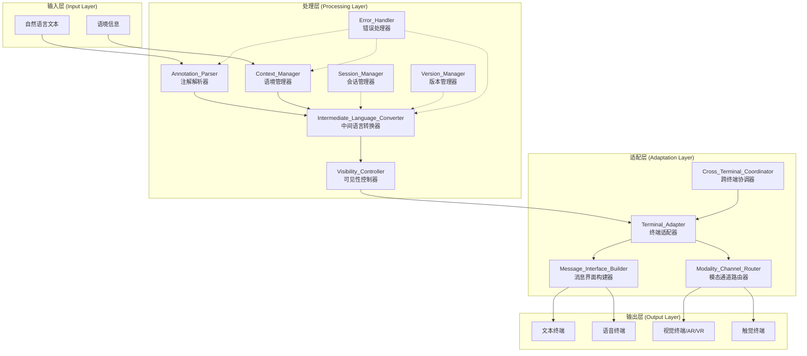
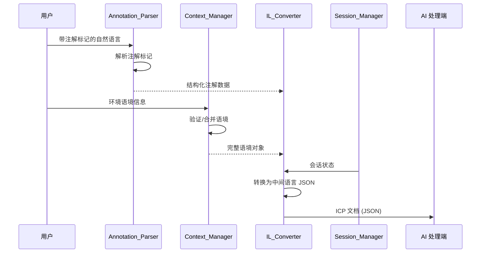
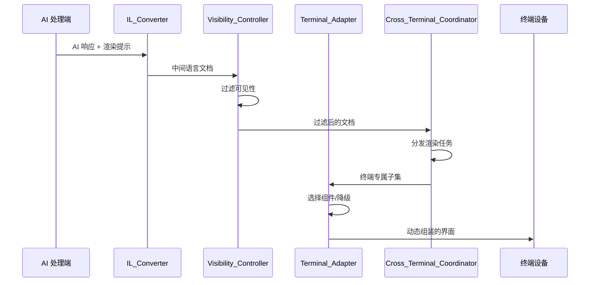
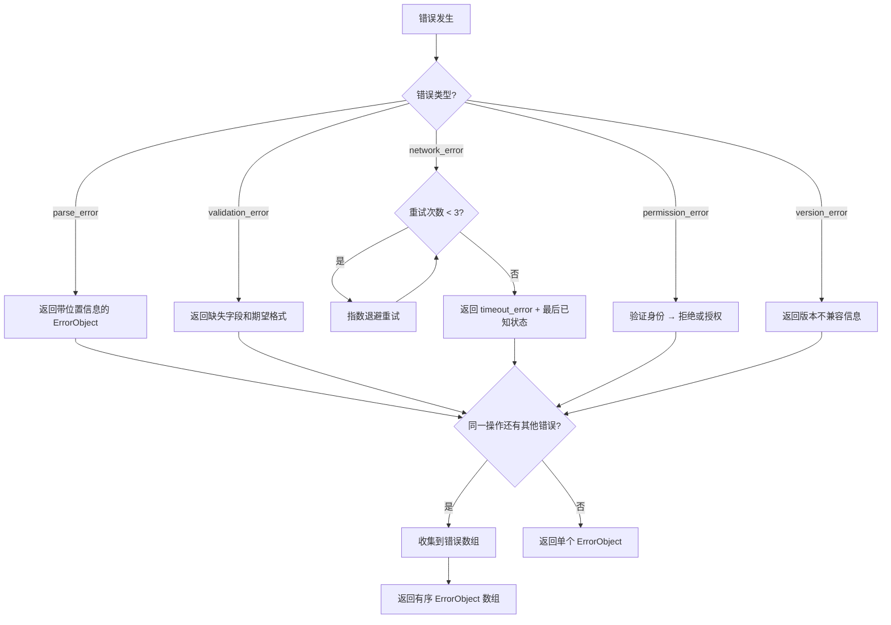

# ICP 协议设计文档

## 概述

本设计文档描述 Interactive Conversation Protocol（ICP）协议的技术架构和实现方案。ICP 是一种面向人机交互的中间语言协议，核心目标是将自然语言中的指示性含义转化为结构化的、可跨终端解读的标准数据格式。

协议围绕以下核心能力展开：
1. **注解标记系统** — 在自然语言文本中嵌入结构化语义标记
2. **语境信息管理** — 捕获和管理交互环境的上下文信息
3. **中间语言转换** — 将注解文本和语境转换为标准 JSON 中间语言
4. **终端适配** — 根据终端能力动态组装交互界面
5. **双向通信** — 支持人→机器和机器→人的完整通信闭环
6. **错误处理** — 结构化的错误报告和容错机制
7. **扩展性** — 自定义注解类型、终端适配器和版本管理
8. **多模态支持** — 文本、语音、视觉、触觉等多通道信息呈现
9. **跨终端协调** — 多终端设备间的语境重现和任务分发
10. **隐私控制** — 基于参与者身份的信息可见性管理

本设计基于现有的 JSON Schema（`schema/2025-10-25/schema.json`）进行扩展，保持向后兼容。

## 架构

### 系统分层架构



### 数据流

#### 人→机器（Human to Machine）



#### 机器→人（Machine to Human）




## 组件与接口

### 1. Annotation_Parser（注解解析器）

负责解析和生成带注解标记的自然语言文本。

```typescript
interface AnnotationParser {
  /** 解析带注解标记的文本，返回结构化注解数据 */
  parse(text: string): ParseResult<AnnotatedText>;

  /** 验证注解标记的格式是否合法 */
  validate(text: string): ValidationResult;
}

interface AnnotationPrettyPrinter {
  /** 将结构化注解数据格式化为带标记的文本 */
  print(annotatedText: AnnotatedText): string;
}

interface AnnotatedText {
  raw_text: string;
  annotations: Annotation[];
}

interface ParseResult<T> {
  success: boolean;
  value?: T;
  errors?: ErrorObject[];
}
```

支持的注解语义类型：
- `emphasis` — 强调标记
- `priority` — 优先级标记
- `datetime` — 日期/时间标记
- `person_ref` — 人物引用标记
- `action_trigger` — 动作触发标记
- `visibility` — 可见性控制标记

注解标记采用 Markdown 风格的特殊字符语法，例如：
- `**重要内容**` → emphasis
- `!!高优先级!!` → priority (high)
- `@张三` → person_ref
- `[2025-01-15]` → datetime
- `{action: 确认}` → action_trigger
- `~private: 敏感内容~` → visibility (private)

### 2. Context_Manager（语境管理器）

负责捕获、验证、合并和序列化语境信息。

```typescript
interface ContextManager {
  /** 验证语境信息的必填字段 */
  validate(context: Partial<ContextInformation>): ValidationResult;

  /** 合并新语境到现有会话语境，最新值优先 */
  merge(existing: ContextInformation, incoming: Partial<ContextInformation>): ContextInformation;

  /** 为缺失的可选字段填充默认值 */
  applyDefaults(context: Partial<ContextInformation>): ContextInformation;
}

interface ContextSerializer {
  /** 将语境信息序列化为 JSON 字符串 */
  serialize(context: ContextInformation): string;

  /** 从 JSON 字符串反序列化为语境信息 */
  deserialize(json: string): ParseResult<ContextInformation>;
}
```

### 3. Intermediate_Language_Converter（中间语言转换器）

负责在注解文本+语境与标准 JSON 中间语言之间进行双向转换。

```typescript
interface IntermediateLanguageConverter {
  /** 将注解文本和语境转换为 ICP 文档 */
  convert(annotatedText: AnnotatedText, context: ContextInformation, metadata?: Metadata): ICPDocument;
}

interface IntermediateLanguageParser {
  /** 从 JSON 解析 ICP 文档 */
  parse(json: string): ParseResult<ICPDocument>;
}

interface IntermediateLanguagePrinter {
  /** 将 ICP 文档序列化为 JSON 字符串 */
  print(doc: ICPDocument): string;
}
```

### 4. Terminal_Adapter（终端适配器）

负责根据终端能力解读中间语言并选择渲染组件。

```typescript
interface TerminalAdapter {
  /** 获取终端支持的能力列表 */
  getCapabilities(): TerminalCapabilities;

  /** 根据中间语言和终端能力选择渲染方案 */
  adapt(doc: ICPDocument): AdaptationResult;

  /** 验证组件类型是否在支持的注册表中 */
  validateComponentType(componentType: string): boolean;

  /** 报告不支持的特性（不中断渲染） */
  reportUnsupported(features: string[]): void;
}

interface MessageInterfaceBuilder {
  /** 从中间语言动态构建界面组件树 */
  build(doc: ICPDocument, capabilities: TerminalCapabilities): InterfaceComponent[];
}

/** 支持的组件类型 */
type ComponentType = 'text_block' | 'form_card' | 'action_button' | 'data_table' | 'media_preview';
```

### 5. Session_Manager（会话管理器）

负责管理通信会话的生命周期。

```typescript
interface SessionManager {
  /** 创建新会话，分配唯一标识符 */
  create(scope: SessionScope): Session;

  /** 恢复已有会话，验证完整性后恢复状态 */
  resume(sessionId: string): ParseResult<Session>;

  /** 更新会话状态 */
  update(sessionId: string, context: ContextInformation): void;

  /** 将超时会话转为非活跃状态并持久化 */
  deactivate(sessionId: string): void;

  /** 验证会话完整性 */
  validateIntegrity(session: Session): ValidationResult;
}

type SessionScope = 'session' | 'document' | 'request';

type SessionState = 'active' | 'inactive' | 'expired';

interface Session {
  id: string;
  scope: SessionScope;
  state: SessionState;
  context: ContextInformation;
  created_at: string;
  last_active_at: string;
  idle_timeout_ms: number;
}
```

### 6. Version_Manager（版本管理器）

负责协议版本的注册、协商和兼容性管理。

```typescript
interface VersionManager {
  /** 注册版本与对应的 schema 定义 */
  register(version: SemanticVersion, schema: object): void;

  /** 解析版本字符串 */
  parseVersion(versionStr: string): SemanticVersion;

  /** 查找最接近的已知版本 */
  findClosestVersion(version: SemanticVersion): SemanticVersion | null;

  /** 检查版本兼容性 */
  checkCompatibility(source: SemanticVersion, target: SemanticVersion): VersionCompatibility;
}

interface SemanticVersion {
  major: number;
  minor: number;
  patch: number;
}

type VersionCompatibility = 'compatible' | 'backward_compatible' | 'incompatible';
```

### 7. Cross_Terminal_Coordinator（跨终端协调器）

负责多终端间的语境同步和渲染任务分发。

```typescript
interface CrossTerminalCoordinator {
  /** 获取会话中所有参与终端 */
  getTerminals(sessionId: string): TerminalInfo[];

  /** 同步语境状态到新加入的终端 */
  syncContext(sessionId: string, terminalId: string): void;

  /** 根据终端能力分发渲染任务 */
  distribute(doc: ICPDocument, terminals: TerminalInfo[]): Map<string, ICPDocument>;

  /** 处理终端断开，重新分配任务 */
  handleDisconnect(sessionId: string, terminalId: string): void;
}

type CollaborationScenario = 'ar_overlay' | 'vr_immersion' | 'screen_projection' | 'multi_device_split';
```

### 8. Visibility_Controller（可见性控制器）

负责基于参与者身份和权限过滤信息可见性。

```typescript
interface VisibilityController {
  /** 根据请求者身份过滤文档内容 */
  filter(doc: ICPDocument, requesterId: string): ICPDocument;

  /** 验证请求者是否有权访问指定内容 */
  checkAccess(requesterId: string, visibilityLevel: VisibilityLevel): boolean;

  /** 验证请求者身份 */
  authenticate(requesterId: string): AuthResult;
}

type VisibilityLevel = 'private' | 'shared' | 'public';
```

### 9. Error_Handler（错误处理器）

负责结构化错误报告和重试逻辑。

```typescript
interface ErrorHandler {
  /** 创建结构化错误对象 */
  createError(type: ErrorType, code: number, message: string, location?: ErrorLocation): ErrorObject;

  /** 收集多个错误 */
  collectErrors(errors: ErrorObject[]): ErrorObject[];

  /** 执行带指数退避重试的操作 */
  withRetry<T>(operation: () => Promise<T>, maxRetries: number): Promise<T>;
}

type ErrorType = 'parse_error' | 'validation_error' | 'network_error' | 'timeout_error' | 'permission_error' | 'version_error';
```

### 10. Extension_Registry（扩展注册表）

负责自定义注解类型和终端适配器的注册管理。

```typescript
interface ExtensionRegistry {
  /** 注册自定义注解类型 */
  registerAnnotationType(typeDef: AnnotationTypeDefinition): ValidationResult;

  /** 注册自定义终端适配器 */
  registerAdapter(adapter: TerminalAdapter): ValidationResult;

  /** 获取已注册的注解类型 */
  getAnnotationType(typeName: string): AnnotationTypeDefinition | null;

  /** 获取已注册的适配器 */
  getAdapter(adapterId: string): TerminalAdapter | null;
}
```

## 数据模型

本节定义 ICP 协议的核心数据模型。设计基于现有 JSON Schema（`schema/2025-10-25/schema.json`）进行扩展，新增字段以 `[NEW]` 标注。

### ICPDocument（ICP 文档）

顶层文档结构，对应现有 schema 的根对象。

```typescript
interface ICPDocument {
  /** 协议版本标识符 */
  version: string;
  /** 文档唯一标识符 */
  id: string;
  /** BCP-47 语言标签 */
  locale?: string;
  /** 创建时间 (RFC 3339) */
  created_at?: string;
  /** Schema 版本引用 (对应需求 7.10) */
  schema_ref?: string;
  /** 语境信息 */
  context?: ContextInformation;
  /** 注册的辅助技能 */
  skills?: Record<string, Skill>;
  /** 有序消息列表 */
  messages: Message[];
}
```

### Message（消息）

消息结构，扩展了 `channel` 字段的枚举定义和渲染提示。

```typescript
interface Message {
  /** 消息唯一标识符 */
  id: string;
  /** 消息角色 */
  role: 'user' | 'assistant' | 'system' | 'tool' | 'other';
  /** [EXTENDED] 主模态通道 (对应需求 8.1, 8.2) */
  channel?: ModalityChannel;
  /** 消息时间戳 */
  timestamp?: string;
  /** 消息体 */
  body: MessageBody;
}

/** [NEW] 模态通道类型 (对应需求 8.1) */
type ModalityChannel = 'text' | 'audio' | 'vision' | 'tactile' | 'multi';

interface MessageBody {
  /** 文本格式 */
  format: string;
  /** 原始文本内容 */
  text: string;
  /** 语义注解列表 */
  annotations?: Annotation[];
}
```

### Annotation（注解）

注解结构，扩展了语义类型和可见性控制。

```typescript
interface Annotation {
  /** 注解唯一标识符 */
  id: string;
  /** 注解类型 (现有: span, highlight, sequence, reference, assistive) */
  type: AnnotationType;
  /** 注解目标 */
  target: AnnotationTarget;
  /** 类型特定的数据载荷 */
  data?: Record<string, any>;
  /** [NEW] 注解级别的模态通道提示 (对应需求 8.5, 8.6) */
  channel_hint?: ModalityChannel;
  /** [NEW] 可见性控制 (对应需求 10.5) */
  visibility?: VisibilityLevel;
}

/** 现有注解类型 + 新增语义标记类型 */
type AnnotationType =
  | 'span' | 'highlight' | 'sequence' | 'reference' | 'assistive'
  /** [NEW] 语义标记类型 (对应需求 1.3) */
  | 'emphasis' | 'priority' | 'datetime' | 'person_ref' | 'action_trigger' | 'visibility_marker';

type VisibilityLevel = 'private' | 'shared' | 'public';

interface AnnotationTarget {
  /** 目标消息 ID */
  message_id: string;
  /** 字符范围 */
  range?: { start: number; end: number };
  /** 逻辑对象 ID */
  object_id?: string;
}
```

### RenderingHint（渲染提示）

新增的渲染提示结构，指导终端选择呈现方式。

```typescript
/** [NEW] 渲染提示 (对应需求 4.7) */
interface RenderingHint {
  /** 首选布局方式 */
  preferred_layout?: 'vertical' | 'horizontal' | 'grid' | 'overlay';
  /** 组件类型 (对应需求 4.4, 4.8) */
  component_type?: ComponentType;
  /** 优先级级别 (影响信息层次) */
  priority_level?: 'critical' | 'high' | 'normal' | 'low';
  /** 降级策略 (对应需求 4.9) */
  fallback_strategy?: FallbackStrategy;
  /** [NEW] 模态特定元数据 (对应需求 8.7) */
  modality_metadata?: ModalityMetadata;
}

type ComponentType = 'text_block' | 'form_card' | 'action_button' | 'data_table' | 'media_preview';

interface FallbackStrategy {
  /** 降级组件类型 */
  fallback_component: ComponentType;
  /** 降级时是否保留交互性 */
  preserve_interactivity: boolean;
}

/** [NEW] 模态特定元数据 (对应需求 8.7) */
interface ModalityMetadata {
  /** 文本通道配置 */
  text?: { format?: string; max_length?: number };
  /** 语音通道配置 */
  audio?: { voice_id?: string; speed?: number; language?: string };
  /** 视觉通道配置 */
  vision?: { resolution?: string; ar_anchor?: string };
  /** 触觉通道配置 */
  tactile?: { pattern?: string; intensity?: number };
}
```

### ContextInformation（语境信息）

语境信息结构，对应现有 schema 的 `context` 定义并扩展。

```typescript
interface ContextInformation {
  /** 语境标识符 */
  id?: string;
  /** 作用域 (对应需求 5.8) */
  scope?: 'session' | 'document' | 'request';
  /** [EXISTING] 是否跨会话可见 (对应需求 10.7) */
  public?: boolean;
  /** 参与者列表 */
  participants?: Participant[];
  /** 记忆系统 */
  memory?: Memory;
  /** 概念列表 */
  concepts?: Concept[];
  /** [EXISTING] 情境信息 (对应需求 9.7) */
  situation?: Situation;
  /** [EXISTING] 环境信息 (对应需求 9.3) */
  environment?: Environment;
  /** 文化信息 */
  culture?: Culture;
  /** [NEW] 时间戳 (对应需求 2.1) */
  timestamp?: string;
  /** [NEW] 位置信息快捷引用 (对应需求 2.1) */
  location_ref?: string;
  /** [NEW] 设备状态快捷引用 (对应需求 2.1) */
  device_state_ref?: string;
  /** [NEW] 会话历史引用 (对应需求 2.1) */
  session_history_ref?: string;
}
```

### ErrorObject（错误对象）

新增的结构化错误表示。

```typescript
/** [NEW] 错误对象 (对应需求 6.1, 6.7, 6.8) */
interface ErrorObject {
  /** 错误类型 */
  error_type: ErrorType;
  /** 错误码 (类型内唯一) */
  error_code: number;
  /** 错误描述消息 */
  message: string;
  /** 错误发生位置 */
  location?: ErrorLocation;
  /** 错误时间戳 */
  timestamp: string;
}

type ErrorType = 'parse_error' | 'validation_error' | 'network_error' | 'timeout_error' | 'permission_error' | 'version_error';

interface ErrorLocation {
  /** 源文本中的字符偏移 */
  offset?: number;
  /** 行号 */
  line?: number;
  /** 列号 */
  column?: number;
  /** 相关字段路径 (如 "context.participants[0].id") */
  field_path?: string;
}
```

### Session（会话）

新增的会话管理数据模型。

```typescript
/** [NEW] 会话对象 (对应需求 5.5-5.10) */
interface Session {
  /** 会话唯一标识符 */
  id: string;
  /** 会话作用域 */
  scope: 'session' | 'document' | 'request';
  /** 会话状态 */
  state: 'active' | 'inactive' | 'expired';
  /** 关联的语境信息 */
  context: ContextInformation;
  /** 创建时间 */
  created_at: string;
  /** 最后活跃时间 */
  last_active_at: string;
  /** 空闲超时时间 (毫秒) */
  idle_timeout_ms: number;
  /** 完整性校验哈希 */
  integrity_hash?: string;
}
```

### SemanticVersion（语义版本）

版本管理数据模型。

```typescript
/** [NEW] 语义版本 (对应需求 7.7) */
interface SemanticVersion {
  major: number;
  minor: number;
  patch: number;
}

/** [NEW] 版本注册表条目 */
interface VersionRegistryEntry {
  version: SemanticVersion;
  schema: object;
  registered_at: string;
}
```

### 与现有 Schema 的映射关系

| 现有 Schema 定义 | 设计扩展 | 对应需求 |
|---|---|---|
| `message.channel` (string) | 枚举化为 `ModalityChannel` 类型 | 需求 8.1, 8.2 |
| `annotation.type` (enum) | 新增语义标记类型 | 需求 1.3 |
| `annotation.data` (object) | 增加 `channel_hint`, `visibility` 字段 | 需求 8.5, 10.5 |
| `context.scope` (enum) | 已存在，直接复用 | 需求 5.8 |
| `context.public` (boolean) | 已存在，直接复用 | 需求 10.7 |
| `context.situation` (object) | 已存在，直接复用 | 需求 9.7 |
| `context.environment` (object) | 已存在，直接复用 | 需求 9.3 |
| `participant.visibility` (enum) | 已存在，直接复用 | 需求 10.1 |
| — (不存在) | 新增 `RenderingHint` | 需求 4.7 |
| — (不存在) | 新增 `ErrorObject` | 需求 6.1, 6.7 |
| — (不存在) | 新增 `Session` | 需求 5.5-5.10 |
| — (不存在) | 新增 `SemanticVersion` | 需求 7.7 |
| — (不存在) | 新增 `ModalityMetadata` | 需求 8.7 |


## 正确性属性

*属性（Property）是指在系统所有合法执行中都应成立的特征或行为——本质上是对系统应做之事的形式化陈述。属性是人类可读规范与机器可验证正确性保证之间的桥梁。*

### Property 1: 注解解析-打印往返一致性

*对于任意*合法的注解文本，执行 parse → print → parse 后得到的注解结构应与首次 parse 的结果等价。

**验证需求: 需求 1.2, 1.5, 1.6**

### Property 2: 畸形注解标记产生带位置的错误

*对于任意*包含畸形注解标记的文本，Annotation_Parser 应返回一个 ErrorObject，其中 location 字段的偏移量指向畸形标记在原始文本中的位置。

**验证需求: 需求 1.4**

### Property 3: 语境验证与默认值填充

*对于任意*部分填充的 ContextInformation 对象，若缺少必填字段则验证应失败并指出缺失字段；若仅缺少可选字段，则 applyDefaults 后所有可选字段应具有非空默认值。

**验证需求: 需求 2.2, 2.3**

### Property 4: 语境合并保留最新值

*对于任意*两个 ContextInformation 对象 A（已有）和 B（新增），当 A 和 B 在同一字段上存在冲突值时，merge(A, B) 的结果中该字段的值应等于 B 中的值。

**验证需求: 需求 2.5**

### Property 5: 语境序列化往返一致性

*对于任意*合法的 ContextInformation 对象，执行 serialize → deserialize 后得到的对象应与原始对象等价。

**验证需求: 需求 2.7**

### Property 6: 中间语言转换保留语义信息

*对于任意*带注解的文本和语境信息，转换为中间语言后，输出的 JSON 结构应包含 message_body、annotations、context、metadata 和 rendering_hints 各节，且源文本中的所有注解和语境字段均应在输出中可找到。

**验证需求: 需求 3.2, 3.3**

### Property 7: 中间语言打印-解析往返一致性

*对于任意*合法的 IntermediateLanguage 对象，执行 print → parse 后得到的对象应与原始对象等价。

**验证需求: 需求 3.7**

### Property 8: 无效 JSON 产生描述性错误

*对于任意*不符合 ICP schema 的 JSON 字符串，IntermediateLanguage_Parser 应返回一个包含验证失败描述的 ErrorObject。

**验证需求: 需求 3.5**

### Property 9: 终端适配器选择兼容组件

*对于任意* ICP 文档和终端能力集合，Terminal_Adapter 选择的所有渲染组件应属于该终端能力集合的子集。当文档中包含终端不支持的特性时，适配器应产生降级但有效的输出，并报告不支持的特性列表，而不中断整体渲染流程。

**验证需求: 需求 4.1, 4.2, 4.6**

### Property 10: 界面构建尊重信息层次

*对于任意*包含不同 priority_level 的 RenderingHint 的 ICP 文档，Message_Interface_Builder 构建的界面组件应按优先级从高到低排列（critical > high > normal > low）。

**验证需求: 需求 4.5**

### Property 11: 渲染提示组件类型验证

*对于任意* RenderingHint 中指定的 component_type，Terminal_Adapter 应在渲染前验证该类型是否存在于已注册的组件类型注册表中；若不存在，应拒绝该组件并使用 fallback_strategy。

**验证需求: 需求 4.8, 4.9**

### Property 12: 双向消息处理完整性

*对于任意* Human_to_Machine 消息，处理后应提取出 meaning、annotations 和 context 三个组成部分；*对于任意* Machine_to_Human 消息，输出应包含 rendering_hints 字段。

**验证需求: 需求 5.3, 5.4**

### Property 13: 会话标识符唯一性

*对于任意*数量的新建会话，Session_Manager 分配的所有 session ID 应互不相同。

**验证需求: 需求 5.7**

### Property 14: 会话停用-恢复往返一致性

*对于任意*活跃会话，执行 deactivate → resume 后恢复的语境信息应与停用前的语境信息等价。

**验证需求: 需求 5.5, 5.6**

### Property 15: 会话空闲超时状态转换

*对于任意*活跃会话，当其空闲时间超过配置的 idle_timeout_ms 时，Session_Manager 应将其状态转换为 inactive 并持久化会话状态。

**验证需求: 需求 5.9**

### Property 16: 非活跃会话恢复前完整性验证

*对于任意*处于 inactive 状态的会话，Session_Manager 在恢复前应验证会话完整性；若完整性校验失败，恢复操作应失败并返回错误。

**验证需求: 需求 5.10**

### Property 17: 错误对象结构完整性

*对于任意*解析失败或必填字段缺失的情况，系统返回的 ErrorObject 应包含 error_type、error_code、message、location 和 timestamp 全部字段；当必填字段缺失时，message 应指明缺失的字段名称和期望格式。

**验证需求: 需求 6.1, 6.2**

### Property 18: 未知注解类型保留原始内容

*对于任意*包含未知注解类型的文本，系统应保留该注解的原始文本内容不丢失，并记录警告日志。

**验证需求: 需求 6.3**

### Property 19: 网络重试与指数退避

*对于任意*网络通信失败，系统应以指数退避策略重试最多 3 次；若全部重试耗尽，应返回 timeout_error 类型的 ErrorObject。

**验证需求: 需求 6.4, 6.5**

### Property 20: 输入数据安全验证

*对于任意*输入数据，系统应在处理前进行验证，拒绝或清理包含注入攻击模式的内容。

**验证需求: 需求 6.6**

### Property 21: 错误码类型内唯一性

*对于任意* error_type，该类型下的所有 error_code 值应互不相同。

**验证需求: 需求 6.8**

### Property 22: 多错误收集与有序返回

*对于任意*在单次操作中触发多个错误的输入，系统应收集所有错误并以有序数组形式返回，数组长度应等于实际发生的错误数量。

**验证需求: 需求 6.9**

### Property 23: 扩展注册验证

*对于任意*自定义注解类型定义，注册时系统应验证其 schema 合法性；*对于任意*自定义终端适配器，注册时系统应验证其实现了所有必需接口方法。不合法的定义或不完整的实现应被拒绝。

**验证需求: 需求 7.2, 7.4**

### Property 24: 版本兼容性处理

*对于任意*消息的版本标识，当 major 版本与当前不同时，系统应拒绝该消息并返回 version_error；当仅 minor 版本不同（major 相同）时，系统应使用向后兼容的解析规则成功处理该消息。

**验证需求: 需求 7.8, 7.9**

### Property 25: 未知版本最近匹配

*对于任意*未在注册表中的版本标识符，Version_Manager 应找到并使用距离最近的已知版本进行解析。

**验证需求: 需求 7.5, 7.6**

### Property 26: 模态通道兼容性与降级

*对于任意*指定了 ModalityChannel 的消息，Terminal_Adapter 应选择与该通道兼容的渲染组件；当终端不支持指定通道时，应降级到 text 通道作为默认回退。

**验证需求: 需求 8.3, 8.4**

### Property 27: 多通道消息逐注解渲染

*对于任意* channel 为 multi 的消息，其每个注解应包含 channel_hint，且 Terminal_Adapter 应根据每个注解的 channel_hint 选择对应的渲染方式。

**验证需求: 需求 8.5, 8.6**

### Property 28: 跨终端语境同步

*对于任意*加入会话的新终端，Cross_Terminal_Coordinator 应将当前会话的完整语境状态同步到该终端，同步后该终端的语境应与会话中其他终端的语境一致。

**验证需求: 需求 9.1, 9.2**

### Property 29: 跨终端渲染任务按能力分发

*对于任意*包含多个终端的会话和待分发的 ICP 文档，Cross_Terminal_Coordinator 应根据每个终端的能力分发渲染任务，每个终端仅接收与其能力匹配的 RenderingHint 子集。

**验证需求: 需求 9.4, 9.6**

### Property 30: 终端断开后任务重新分配

*对于任意*跨终端会话中的终端断开事件，Cross_Terminal_Coordinator 应将断开终端的渲染任务重新分配给剩余终端。

**验证需求: 需求 9.8**

### Property 31: 可见性级别访问控制

*对于任意*参与者和可见性级别组合：当 visibility 为 private 时，仅经过认证的该参与者本人可访问其信息；当 visibility 为 shared 时，同一会话内的所有参与者可访问；当 visibility 为 public 时，跨会话均可访问。

**验证需求: 需求 10.2, 10.3, 10.4**

### Property 32: 混合可见性内容过滤

*对于任意*包含不同可见性级别内容的消息，Visibility_Controller 应根据请求者身份过滤消息，返回的内容应仅包含该请求者有权访问的部分；需要认证的内容在请求者未通过身份验证时应被排除。

**验证需求: 需求 10.6, 10.8**


## 错误处理

### 错误分类体系

| 错误类型 | 错误码范围 | 描述 | 示例 |
|---|---|---|---|
| `parse_error` | 1000-1999 | 注解标记或 JSON 解析失败 | 畸形注解标记、无效 JSON 语法 |
| `validation_error` | 2000-2999 | 数据验证失败 | 必填字段缺失、类型不匹配、schema 不合规 |
| `network_error` | 3000-3999 | 网络通信失败 | 连接超时、DNS 解析失败 |
| `timeout_error` | 4000-4999 | 操作超时 | 会话空闲超时、重试耗尽 |
| `permission_error` | 5000-5999 | 权限或认证失败 | 未认证访问私有内容、可见性级别不足 |
| `version_error` | 6000-6999 | 版本兼容性问题 | 主版本不兼容、未知版本 |

### 错误处理策略



### 容错原则

1. **未知注解保留原始内容**：遇到未知注解类型时，保留原始文本内容，记录警告，不中断处理流程。
2. **终端降级不中断**：终端不支持的特性通过降级处理，报告不支持列表，但不中断整体渲染。
3. **输入安全验证前置**：所有输入数据在进入处理流程前进行安全验证，防止注入攻击。
4. **多错误批量收集**：单次操作中的多个错误全部收集后统一返回，避免用户逐个修复。

## 测试策略

### 双轨测试方法

本项目采用单元测试与属性测试（Property-Based Testing）相结合的双轨测试策略：

- **单元测试**：验证具体示例、边界情况和错误条件
- **属性测试**：验证跨所有输入的通用属性

两者互补，缺一不可。

### 属性测试配置

- **测试库**：使用 [fast-check](https://github.com/dubzzz/fast-check)（TypeScript/JavaScript 属性测试库）
- **最小迭代次数**：每个属性测试至少运行 100 次迭代
- **标签格式**：每个属性测试必须包含注释引用设计文档中的属性编号
  - 格式：`Feature: icp-protocol, Property {number}: {property_text}`
- **每个正确性属性必须由单个属性测试实现**

### 单元测试覆盖

单元测试应聚焦于：

1. **具体示例**：
   - 每种注解语义类型（emphasis, priority, datetime, person_ref, action_trigger, visibility）的解析示例
   - 每种组件类型（text_block, form_card, action_button, data_table, media_preview）的构建示例
   - 每种会话作用域（session, document, request）的创建示例
   - 每种模态通道（text, audio, vision, tactile, multi）的消息示例
   - 每种协作场景（ar_overlay, vr_immersion, screen_projection, multi_device_split）的示例
   - 每种可见性级别（private, shared, public）的访问控制示例

2. **边界情况**：
   - 空文本输入的注解解析
   - 空语境对象的验证和默认值填充
   - 单终端会话的跨终端协调
   - 所有终端断开后的会话状态

3. **错误条件**：
   - 每种 error_type 的错误对象创建
   - 网络重试耗尽后的超时错误
   - 主版本不兼容的版本错误
   - 未认证用户访问私有内容的权限错误

### 属性测试覆盖

每个正确性属性（Property 1-32）对应一个属性测试，使用 fast-check 的 `fc.assert` 和 `fc.property` 实现。

关键生成器（Arbitrary）：

```typescript
// 注解文本生成器
const annotatedTextArb: fc.Arbitrary<AnnotatedText>;

// 语境信息生成器
const contextInfoArb: fc.Arbitrary<ContextInformation>;

// ICP 文档生成器
const icpDocumentArb: fc.Arbitrary<ICPDocument>;

// 终端能力生成器
const terminalCapabilitiesArb: fc.Arbitrary<TerminalCapabilities>;

// 会话生成器
const sessionArb: fc.Arbitrary<Session>;

// 语义版本生成器
const semanticVersionArb: fc.Arbitrary<SemanticVersion>;

// 参与者与可见性生成器
const participantWithVisibilityArb: fc.Arbitrary<Participant>;

// 错误对象生成器
const errorObjectArb: fc.Arbitrary<ErrorObject>;
```

### 测试优先级

| 优先级 | 属性编号 | 说明 |
|---|---|---|
| P0 (核心往返) | 1, 5, 7, 14 | 往返一致性是协议正确性的基础 |
| P0 (安全) | 20, 31, 32 | 安全和隐私控制不可妥协 |
| P1 (数据完整性) | 3, 4, 6, 8, 17 | 数据验证和错误报告 |
| P1 (版本兼容) | 24, 25 | 版本管理影响互操作性 |
| P2 (终端适配) | 9, 10, 11, 26, 27 | 渲染和适配逻辑 |
| P2 (会话管理) | 13, 15, 16 | 会话生命周期 |
| P3 (跨终端) | 28, 29, 30 | 跨终端协调 |
| P3 (扩展性) | 23 | 扩展注册 |
| P3 (容错) | 2, 18, 19, 21, 22, 12 | 错误处理和容错 |
