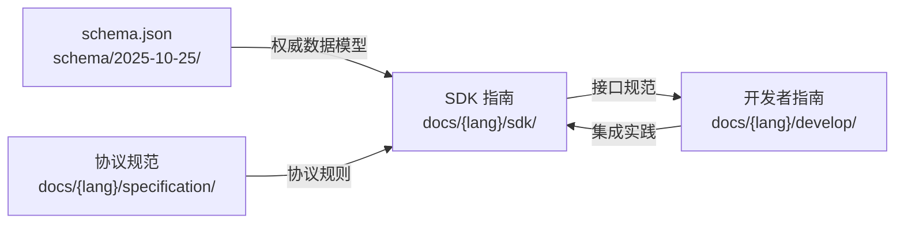
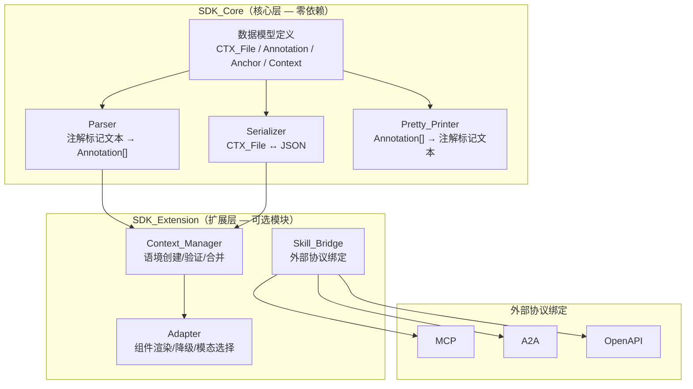
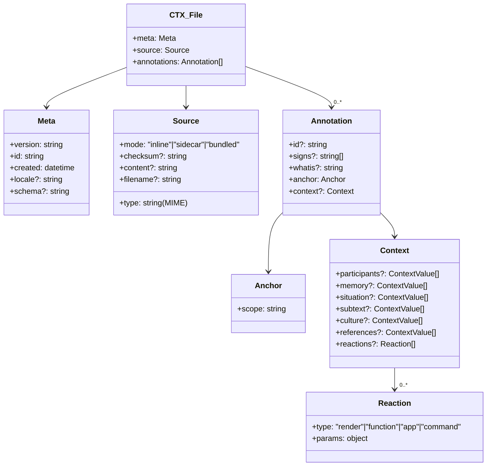

# SDK 指南设计文档

## 概述

本设计文档描述 ICP SDK 指南文档（`docs/{lang}/sdk/`）的内容架构和编写方案。SDK 指南是面向 SDK 开发者和使用者的技术文档，定义 ICP SDK 的接口规范、多语言实现指引、使用教程和测试发布规范。

ICP 现已演进为**上下文注解格式规范（Contextual Annotation Format Specification）**，核心产物为 `.ctx` 文件。SDK 的两大核心职责：

1. **组装（Assemble）**：给定文本/媒体内容及上下文信息，组装为符合 `schema.json` 的 `.ctx` 文件
2. **解析（Parse）**：读取 `.ctx` 文件，解析其结构并渲染对应的交互界面

SDK 指南不包含 SDK 源代码（源代码位于独立仓库），而是定义接口规范和使用文档，确保各语言 SDK 实现的一致性。

### 与其他文档的关系



- **协议规范**定义 `.ctx` 文件格式和处理规则
- **SDK 指南**定义 SDK 接口契约和实现规范（本文档范围）
- **开发者指南**基于 SDK 接口进行系统集成和应用开发
- **schema.json** 是所有接口契约的权威数据模型来源

## 架构

### SDK 分层架构

SDK 采用两层架构设计，确保核心功能的稳定性和扩展功能的灵活性：



### 文档目录结构

SDK 指南文档位于 `docs/{lang}/sdk/`，按以下结构组织：

```
docs/{lang}/sdk/
├── index.md                    # SDK 指南首页与导航
├── architecture.md             # 设计原则与架构规范（需求 1）
├── core/
│   ├── parser-serializer.md    # Parser 与 Serializer 接口规范（需求 2）
│   └── context-adapter.md     # Context_Manager 与 Adapter 接口规范（需求 3）
├── languages/
│   ├── typescript.md           # TypeScript/JavaScript 实现指引
│   ├── python.md               # Python 实现指引
│   ├── java.md                 # Java 实现指引
│   ├── go.md                   # Go 实现指引
│   └── rust.md                 # Rust 实现指引（需求 4）
├── tutorials/
│   ├── assembling.md           # ICP 文档组装教程（需求 5）
│   └── parsing-rendering.md   # ICP 文档解析与渲染教程（需求 6）
└── testing/
    └── conformance.md          # 测试与发布规范（需求 7）
```

### .ctx 文件数据模型概览

SDK 接口围绕 `.ctx` 文件的核心数据结构设计。根据 `schema/2025-10-25/schema.json`：



## 组件与接口

### 1. 数据模型定义（Data Model）

SDK_Core 的基础层，定义与 `schema.json` 一一对应的类型系统。

**TypeScript 规范接口**（作为各语言实现的参考）：

```typescript
/** .ctx 文件根对象 */
interface CTXFile {
  meta: Meta;
  source: Source;
  annotations: Annotation[];
}

interface Meta {
  version: string;
  id: string;
  created: string; // RFC 3339
  locale?: string;
  schema?: string;
}

interface Source {
  mode: 'inline' | 'sidecar' | 'bundled';
  type: string; // MIME type
  checksum?: string;
  content?: string;
  filename?: string;
}

interface Annotation {
  id?: string;
  signs?: Sign[];
  whatis?: Whatis;
  anchor: Anchor;
  context?: Context;
}

type Sign = 'highlight' | 'warning' | 'question' | 'secret' | `${string}:${string}`;
type Whatis = 'person' | 'organization' | 'event' | 'time' | 'place' | 'term' | 'object' | 'skill' | 'emotion';
```

### 2. Anchor 类型系统

Anchor 定义注解在源内容中的附着位置，支持 6 种 scope：

```typescript
type Anchor =
  | GlobalAnchor
  | CoordinateAnchor
  | MarkerAnchor
  | FeatureAnchor
  | PatternAnchor
  | AnnotationAnchor;

interface GlobalAnchor {
  scope: 'global';
}

interface CoordinateAnchor {
  scope: 'coordinate';
  text?: { start: number; end: number };
  image?: RectRegion | PolygonRegion;
  video?: { start: number; end: number; region?: RectRegion | PolygonRegion };
  audio?: { start: number; end: number };
}

interface MarkerAnchor {
  scope: 'marker';
  name: string;
}

interface FeatureAnchor {
  scope: 'feature';
  kind: string;
  value: string;
  sample?: Anchor;
}

interface PatternAnchor {
  scope: 'pattern';
  rule: string; // "regex" | "css-selector" | "xpath"
  expression: string;
}

interface AnnotationAnchor {
  scope: 'annotation';
  ref: string; // 目标 annotation 的 id
}
```

### 3. Context 与 ContextValue

```typescript
interface Context {
  participants?: ContextValue[];
  memory?: ContextValue[];
  situation?: ContextValue[];
  subtext?: ContextValue[];
  culture?: ContextValue[];
  references?: ContextValue[];
  reactions?: Reaction[];
}

/** 除 reactions 外的字段支持 3 种值形式 */
type ContextValue = string | Anchor;
// string 可以是纯文本描述或 URL

interface Reaction {
  type: 'render' | 'function' | 'app' | 'command';
  params: Record<string, unknown>;
}
```

### 4. Parser 接口

```typescript
interface Parser {
  /** 解析注解标记文本，返回 Annotation 数组 */
  parseAnnotations(text: string): ParseResult<Annotation[]>;

  /** 反序列化 JSON 字符串为 CTXFile 对象 */
  deserialize(json: string): ParseResult<CTXFile>;
}

interface ParseResult<T> {
  success: boolean;
  value?: T;
  errors?: ErrorObject[];
}

interface ErrorObject {
  error_type: 'parse_error' | 'validation_error';
  error_code: number;
  message: string;
  location?: ErrorLocation;
}

interface ErrorLocation {
  offset?: number;
  line?: number;
  column?: number;
  field_path?: string;
}
```

### 5. Serializer 接口

```typescript
interface Serializer {
  /** 将 CTXFile 内存对象序列化为 JSON 字符串 */
  serialize(doc: CTXFile): string;
}
```

### 6. Pretty_Printer 接口

```typescript
interface PrettyPrinter {
  /** 将 Annotation 数组格式化为注解标记语法文本 */
  print(annotations: Annotation[]): string;
}
```

### 7. Context_Manager 接口（SDK_Extension）

```typescript
interface ContextManager {
  /** 创建新的 Context 对象 */
  create(params: Partial<Context>): Context;

  /** 验证 Context 对象的合法性 */
  validate(context: Context): ValidationResult;

  /** 合并两个 Context，冲突字段取最新值 */
  merge(existing: Context, incoming: Partial<Context>): Context;

  /** 设置作用域（session / document / request） */
  setScope(scope: ContextScope): void;
}

type ContextScope = 'session' | 'document' | 'request';

interface ValidationResult {
  valid: boolean;
  errors?: string[];
}
```

### 8. Adapter 接口（SDK_Extension）

```typescript
interface Adapter {
  /** 渲染 Annotation 为终端组件 */
  render(annotation: Annotation): RenderedComponent;

  /** 报告终端支持的能力 */
  getCapabilities(): AdapterCapabilities;

  /** 处理降级 */
  fallback(annotation: Annotation, strategy?: FallbackStrategy): RenderedComponent;
}

interface AdapterCapabilities {
  componentTypes: ComponentType[];
  modalityChannels: ModalityChannel[];
}

type ComponentType = 'text_block' | 'form_card' | 'action_button' | 'data_table' | 'media_preview';
type ModalityChannel = 'text' | 'audio' | 'vision' | 'tactile' | 'multi';

interface FallbackStrategy {
  fallbackComponent: ComponentType;
  preserveInteractivity: boolean;
}

interface RenderedComponent {
  type: ComponentType;
  content: unknown;
}
```

## 数据模型

### 文档内容模型

SDK 指南的每个文档页面遵循统一的内容结构模型：

```typescript
/** SDK 指南文档页面的内容结构 */
interface SDKGuidePage {
  /** 页面标题 */
  title: string;
  /** 页面简介（1-2 段） */
  introduction: string;
  /** 内容章节 */
  sections: Section[];
  /** 相关链接 */
  relatedLinks: RelatedLink[];
}

interface Section {
  heading: string;
  content: string;
  /** 代码示例（TypeScript 为主） */
  codeExamples?: CodeExample[];
  /** JSON 示例 */
  jsonExamples?: string[];
  /** 图表（Mermaid） */
  diagrams?: string[];
}

interface CodeExample {
  language: 'typescript' | 'python' | 'java' | 'go' | 'rust';
  code: string;
  description: string;
}

interface RelatedLink {
  title: string;
  path: string;
}
```

### 各文档页面内容规划

#### 1. `architecture.md` — 设计原则与架构规范

| 章节 | 内容要点 | 对应需求 |
|---|---|---|
| 设计原则 | 轻量级、零依赖核心、可扩展、惯用风格 | 1.2 |
| 分层架构 | SDK_Core（Parser + Serializer + 数据模型）与 SDK_Extension（Context_Manager + Adapter + Skill_Bridge） | 1.1 |
| 依赖关系图 | SDK_Core → SDK_Extension → 外部协议绑定（MCP, A2A, OpenAPI）的 Mermaid 图 | 1.4 |
| Schema 引用 | 所有实现引用 `schema/2025-10-25/schema.json` 作为权威数据模型 | 1.3 |
| 版本策略 | SDK_Core 公开 API 稳定，破坏性变更需主版本号递增 | 1.5 |

#### 2. `core/parser-serializer.md` — Parser 与 Serializer 接口规范

| 章节 | 内容要点 | 对应需求 |
|---|---|---|
| Parser.parseAnnotations | 接受注解标记文本，返回 Annotation[] | 2.1 |
| Serializer.serialize | 接受 CTXFile 内存对象，返回符合 schema.json 的 JSON | 2.2 |
| Parser.deserialize | 接受 JSON 字符串，返回经验证的 CTXFile 对象 | 2.3 |
| PrettyPrinter.print | 接受 Annotation[]，返回注解标记语法文本 | 2.4 |
| 往返属性：Serializer | serialize → deserialize 产生等价对象 | 2.5 |
| 往返属性：Parser | parse → print → parse 产生等价结构 | 2.6 |
| 错误处理 | 畸形输入返回 ErrorObject（error_type, error_code, message, location） | 2.7 |
| TypeScript 规范接口 | 所有方法签名的 TypeScript 接口定义 | 2.8 |

#### 3. `core/context-adapter.md` — Context_Manager 与 Adapter 接口规范

| 章节 | 内容要点 | 对应需求 |
|---|---|---|
| Context_Manager 接口 | create / validate / merge / setScope 方法 | 3.1 |
| 合并策略 | 冲突字段取最新值 | 3.2 |
| Adapter 接口 | render / fallback / getCapabilities 方法 | 3.3 |
| 能力报告 | 返回支持的 ComponentType 和 ModalityChannel 列表 | 3.4 |
| 组件降级 | 不支持时使用 FallbackStrategy，无策略时降级到 text_block | 3.5 |
| 通道降级 | 不支持指定 ModalityChannel 时降级到 text 通道 | 3.6 |

#### 4. `languages/*.md` — 多语言实现指引

每个语言文件包含以下统一章节：

| 章节 | 内容要点 | 对应需求 |
|---|---|---|
| 项目结构 | 推荐的目录布局和模块组织 | 4.2 |
| 包命名 | 语言生态的命名约定 | 4.2 |
| 数据模型映射 | ICP 类型在该语言中的表示方式 | 4.3 |
| 错误处理 | 该语言的惯用错误处理模式 | 4.2 |
| 发布目标 | 对应的包注册表（npm/PyPI/Maven/pkg.go.dev/crates.io） | 4.5 |

TypeScript/JavaScript 作为参考实现，其他语言实现需达到功能等价（需求 4.4）。

各语言的数据模型映射策略（需求 4.3）：

| 语言 | 数据模型表示 | 序列化方案 |
|---|---|---|
| TypeScript | `interface` + 联合类型 | 原生 `JSON.parse/stringify` |
| Python | `dataclass` + `Enum` | `json` 模块 + 自定义 encoder |
| Java | `record` + `sealed interface` | Jackson / Gson |
| Go | `struct` + `json` tag | `encoding/json` |
| Rust | `struct` + `#[derive(Serialize)]` | `serde` + `serde_json` |

#### 5. `tutorials/assembling.md` — ICP 文档组装教程

| 章节 | 内容要点 | 对应需求 |
|---|---|---|
| 端到端工作流 | 原始文本 → 注解标记 → 附加上下文 → 添加 reactions → 序列化为 JSON | 5.1 |
| 分步代码示例 | 创建 Meta、Source、Annotation（含 anchor/signs/whatis/context）、序列化 | 5.2 |
| 完整 TypeScript 示例 | 组装包含多个注解和上下文的完整 .ctx 文件 | 5.3 |
| Schema 验证 | 组装后对照 schema.json 验证 | 5.4 |

#### 6. `tutorials/parsing-rendering.md` — ICP 文档解析与渲染教程

| 章节 | 内容要点 | 对应需求 |
|---|---|---|
| 端到端工作流 | JSON → 反序列化 → 提取注解 → 选择组件 → 降级处理 → 组装界面 | 6.1 |
| 分步代码示例 | 反序列化、遍历 annotations、根据 reactions 选择组件、应用降级 | 6.2 |
| 完整 TypeScript 示例 | 解析 .ctx 文件并渲染 text_block、form_card、action_button | 6.3 |
| 未知类型处理 | 未知注解类型保留为原始内容，不中断处理 | 6.4 |

#### 7. `testing/conformance.md` — 测试与发布规范

| 章节 | 内容要点 | 对应需求 |
|---|---|---|
| 一致性测试套件 | 所有语言 SDK 必须通过的测试规范 | 7.1 |
| 往返属性测试 | Parser/Serializer 和 Parser/PrettyPrinter 的往返测试 | 7.2 |
| 错误处理测试 | 畸形输入产生正确的 ErrorObject | 7.3 |
| 版本策略 | 语义版本，SDK 主版本对应 ICP 协议主版本 | 7.4 |
| 兼容性矩阵 | 每次发布包含支持的协议版本和 schema 版本 | 7.5 |
| 发布清单 | 一致性测试通过 → API 文档生成 → changelog 更新 → 发布到注册表 | 7.6 |

### SDK 接口与 .ctx 文件格式的映射

| SDK 接口方法 | 输入 | 输出 | .ctx 文件对应 |
|---|---|---|---|
| `Parser.parseAnnotations(text)` | 注解标记文本 | `Annotation[]` | `annotations` 数组 |
| `Parser.deserialize(json)` | JSON 字符串 | `CTXFile` | 完整 .ctx 文件 |
| `Serializer.serialize(doc)` | `CTXFile` 对象 | JSON 字符串 | 完整 .ctx 文件 |
| `PrettyPrinter.print(anns)` | `Annotation[]` | 注解标记文本 | `annotations` 的文本表示 |
| `ContextManager.create(params)` | 部分 Context | `Context` | `annotation.context` |
| `ContextManager.merge(a, b)` | 两个 Context | 合并后的 `Context` | `annotation.context` |
| `Adapter.render(ann)` | `Annotation` | `RenderedComponent` | 基于 `reactions` 渲染 |
| `Adapter.getCapabilities()` | — | `AdapterCapabilities` | 决定 reaction 处理方式 |


## 正确性属性

*属性（Property）是指在系统所有合法执行中都应成立的特征或行为——本质上是对系统应做之事的形式化陈述。属性是人类可读规范与机器可验证正确性保证之间的桥梁。*

本项目的交付物是文档，但文档中定义的 SDK 接口契约包含可测试的行为属性。以下属性适用于所有遵循 SDK 指南实现的 SDK。

### Property 1: Serializer 序列化-反序列化往返一致性

*对于任意*合法的 CTXFile 内存对象，执行 `Serializer.serialize()` 然后 `Parser.deserialize()` 后得到的 CTXFile 对象应与原始对象结构等价（字段值相同、数组顺序一致）。

**验证需求: 需求 2.5**

### Property 2: Parser/PrettyPrinter 解析-打印往返一致性

*对于任意*合法的注解标记文本，执行 `Parser.parseAnnotations()` → `PrettyPrinter.print()` → `Parser.parseAnnotations()` 后得到的 Annotation 数组应与首次解析的结果结构等价。

**验证需求: 需求 2.6**

### Property 3: 畸形输入产生结构化错误

*对于任意*畸形的注解标记文本或不合法的 JSON 输入，Parser 应返回一个 `ParseResult`，其中 `success` 为 `false`，且 `errors` 数组中每个 ErrorObject 均包含 `error_type`、`error_code`、`message` 和 `location` 四个字段。

**验证需求: 需求 2.7**

### Property 4: Context 合并取最新值

*对于任意*两个 Context 对象 A（已有）和 B（新增），当 A 和 B 在同一字段（如 `participants`、`memory`、`situation` 等）上存在冲突值时，`ContextManager.merge(A, B)` 的结果中该字段的值应等于 B 中的值。

**验证需求: 需求 3.2**

### Property 5: 不支持的能力触发优雅降级

*对于任意* Annotation 和终端能力集合，当 Annotation 的 reaction 请求的 ComponentType 不在终端支持列表中时，Adapter 应使用 FallbackStrategy 指定的降级组件；当未提供 FallbackStrategy 时，应降级到 `text_block`。同理，当请求的 ModalityChannel 不在终端支持列表中时，应降级到 `text` 通道。在所有降级情况下，渲染流程不应中断。

**验证需求: 需求 3.5, 3.6**

### Property 6: 未知注解类型保留原始内容

*对于任意*包含未知 `whatis` 值或自定义 `signs`（如 `vendor:customsign`）的 CTXFile，Parser 在反序列化时应保留这些未知类型的原始数据不丢失，不中断处理流程。

**验证需求: 需求 6.4**

## 错误处理

### SDK 错误分类

SDK 指南文档中需定义以下错误处理规范，供各语言 SDK 实现遵循：

| 错误类型 | 场景 | 处理方式 |
|---|---|---|
| `parse_error` | 注解标记语法错误、JSON 格式错误 | 返回 ErrorObject，包含 location 指向错误位置 |
| `validation_error` | CTXFile 不符合 schema.json 约束 | 返回 ErrorObject，包含 field_path 指向违规字段 |

### 错误对象结构

所有 SDK 实现必须返回统一结构的错误对象：

```typescript
interface ErrorObject {
  error_type: 'parse_error' | 'validation_error';
  error_code: number;
  message: string;
  location?: {
    offset?: number;
    line?: number;
    column?: number;
    field_path?: string;
  };
}
```

### 文档中需覆盖的错误场景

SDK 指南需为以下场景提供错误处理说明和代码示例：

1. **注解标记解析错误**：未闭合的标记、嵌套错误、转义字符错误
2. **JSON 反序列化错误**：无效 JSON 语法、缺少必填字段（meta.version, meta.id, meta.created, source.mode, source.type）
3. **Schema 验证错误**：字段类型不匹配、枚举值非法（如 source.mode 不在 inline/sidecar/bundled 中）
4. **未知类型处理**：未知的 whatis 值或自定义 signs 应保留原始内容并记录警告
5. **Anchor scope 验证**：anchor.scope 不在 6 种合法值中时的处理

## 测试策略

### 双轨测试方法

SDK 指南的测试与发布规范章节（`testing/conformance.md`）需定义以下双轨测试策略：

- **单元测试**：验证具体示例、边界情况和错误条件
- **属性测试（Property-Based Testing）**：验证跨所有输入的通用属性

两者互补，单元测试捕获具体 bug，属性测试验证通用正确性。

### 属性测试配置

- **测试库**：TypeScript/JavaScript 使用 [fast-check](https://github.com/dubzzz/fast-check)；Python 使用 [Hypothesis](https://hypothesis.readthedocs.io/)；Java 使用 [jqwik](https://jqwik.net/)；Go 使用 [rapid](https://github.com/flyingmutant/rapid)；Rust 使用 [proptest](https://github.com/proptest-rs/proptest)
- **最小迭代次数**：每个属性测试至少运行 100 次迭代
- **标签格式**：每个属性测试必须包含注释引用设计文档中的属性编号
  - 格式：`Feature: icp-sdk-guide, Property {number}: {property_text}`
- **每个正确性属性由单个属性测试实现**

### 一致性测试套件规范

SDK 指南需定义所有语言 SDK 必须通过的一致性测试套件，包含：

#### 属性测试覆盖

| 属性编号 | 测试内容 | 生成器 |
|---|---|---|
| Property 1 | Serializer 往返 | 随机合法 CTXFile 对象 |
| Property 2 | Parser/PrettyPrinter 往返 | 随机合法注解标记文本 |
| Property 3 | 畸形输入错误结构 | 随机畸形文本和 JSON |
| Property 4 | Context 合并最新值 | 随机 Context 对象对 |
| Property 5 | 能力降级 | 随机 Annotation + 随机终端能力 |
| Property 6 | 未知类型保留 | 含自定义 signs/whatis 的 CTXFile |

#### 关键生成器（以 TypeScript fast-check 为例）

```typescript
// CTXFile 生成器
const ctxFileArb: fc.Arbitrary<CTXFile>;

// Annotation 生成器（含所有 anchor scope 变体）
const annotationArb: fc.Arbitrary<Annotation>;

// Context 生成器（含 contextValue 的 3 种形式）
const contextArb: fc.Arbitrary<Context>;

// 畸形输入生成器
const malformedTextArb: fc.Arbitrary<string>;
const malformedJsonArb: fc.Arbitrary<string>;

// 终端能力生成器
const adapterCapabilitiesArb: fc.Arbitrary<AdapterCapabilities>;
```

#### 单元测试覆盖

单元测试应聚焦于：

1. **具体示例**：
   - 每种 anchor scope（global, coordinate, marker, feature, pattern, annotation）的解析示例
   - 每种 signs（highlight, warning, question, secret）的处理示例
   - 每种 whatis（person, organization, event, time, place, term, object, skill, emotion）的处理示例
   - 每种 source mode（inline, sidecar, bundled）的序列化示例
   - 每种 reaction type（render, function, app, command）的渲染示例
   - contextValue 的 3 种形式（文本字符串、anchor 对象、URL 字符串）的处理示例

2. **边界情况**：
   - 空 annotations 数组的 CTXFile
   - 无 context 的 Annotation
   - 无 signs 和无 whatis 的 Annotation
   - sidecar 模式下缺少 checksum 的验证错误

3. **错误条件**：
   - 缺少 meta.version 的 JSON 反序列化
   - 非法 source.mode 值的验证
   - 非法 anchor.scope 值的解析
   - 畸形 coordinate anchor（start > end）的验证
