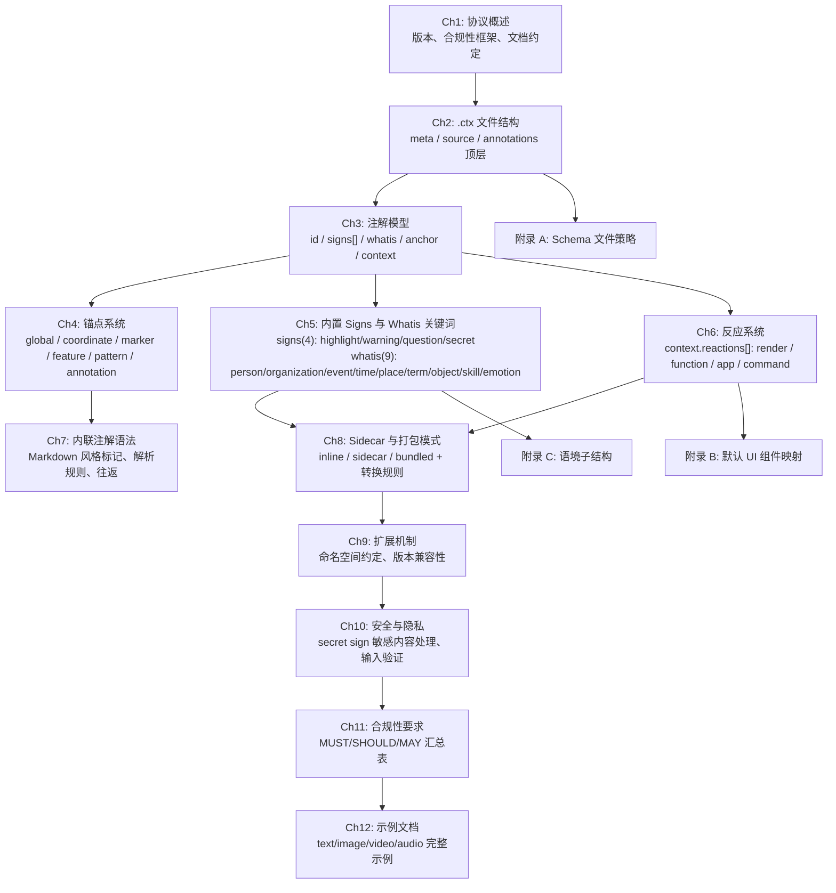
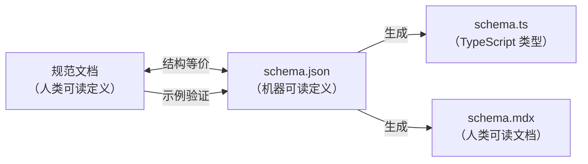

# ICP 规范文档设计（语境注解格式）

## 概述

本设计文档定义 ICP（Interactive Conversation Protocol）协议规范文档的内容规划。ICP 是一种**语境注解格式规范**（Contextual Annotation Format Specification），其核心产物是 `.ctx` 文件（语境注解文件，Contextual Annotation File）。

本设计的交付物是**协议规范文档**的内容结构与章节大纲，而非软件实现。规范文档将：
- 位于 `docs/{lang}/specification/` 目录，采用单文件+章节编号格式（类似 RFC 7540 / RFC 6455）
- 以 `schema/` 目录下的 `schema.json` 作为权威数据源（Single Source of Truth）

### 核心设计理念

- **一切皆注解** — 语义、意图/动机、语境（参与者、记忆、情境、文化）、技能调用、消息引用均为注解
- **一个 .ctx 文件 = 一条消息** — 对话组织由应用层处理，不属于 ICP 范畴
- **两种注解模式** — 内联模式（嵌入文本内容中，类 Markdown 语法）和 Sidecar 模式（外部注解层）
- **三种打包形态** — 内联（inline）、旁注（sidecar）、捆绑（bundled）
- **静态文档格式** — .ctx 文件以纯文本/JSON 存储，通过任意通道传输
- **注解结构** — 每个注解包含 id（可选）、signs[]（标记性质，可选）、whatis（对象类型，可选）、anchor（锚点）、context（语境子结构，含 participants[]/memory[]/situation[]/subtext[]/culture[]/references[]/reactions[]，除 reactions 外所有字段为 contextValue 数组）

### 设计约束

- 中文（zh-CN）为主语言版本，技术术语首次出现时附英文原文
- 规范文档使用 RFC 2119 关键词（MUST / MUST NOT / SHOULD / SHOULD NOT / MAY），大写表示规范性要求
- schema.json 是权威数据源，schema.ts 和 schema.mdx 均由其生成
- 本设计关注"文档内容规划"和".ctx 格式定义"，不涉及软件架构

### 需求覆盖映射

| 规范章节 | 覆盖需求 |
|---|---|
| Ch1：协议概述 | 需求 15（文档结构与格式） |
| Ch2：.ctx 文件结构 | 需求 1（顶层结构） |
| Ch3：注解模型 | 需求 2（注解核心定义：id/signs/whatis/anchor/context） |
| Ch4：锚点系统 | 需求 3（6 种锚点 scope：global/coordinate/marker/feature/pattern/annotation） |
| Ch5：内置 Signs 与 Whatis 关键词 | 需求 4（signs 标记关键词 4 个 + whatis 对象类型关键词 9 个） |
| Ch6：反应系统 | 需求 5（context.reactions：render/function/app/command） |
| Ch7：内联注解语法 | 需求 6（Markdown 风格语法） |
| Ch8：Sidecar 与打包模式 | 需求 7, 9（sidecar 格式 + 三种打包模式） |
| Ch9：扩展机制 | 需求 11（命名空间约定） |
| Ch10：安全与隐私 | 需求 12（secret sign 敏感内容处理、输入验证） |
| Ch11：合规性要求 | 需求 15（MUST/SHOULD/MAY 汇总） |
| Ch12：示例文档 | 需求 14（text/image/video/audio 示例） |
| 附录 A：Schema 文件策略 | 需求 13（schema.json 管理规则） |
| 附录 B：默认 UI 组件映射 | 需求 10（render 反应组件映射） |
| 附录 C：语境子结构 | 需求 8（context 子结构：participants[]/memory[]/situation[]/subtext[]/culture[]/references[]/reactions[]，统一 contextValue 类型） |


## 架构

### 规范文档章节结构

规范文档采用"概述 → 核心格式 → 类型系统 → 语法规则 → 打包模式 → 扩展与安全 → 示例"的叙事逻辑。



### 章节间依赖关系

- Ch2（.ctx 文件结构）是所有后续章节的基础，定义了 CTX_File 的三个顶层节
- Ch3（注解模型）引用 Ch2 的 annotations 数组，定义 Annotation 核心结构（id/signs/whatis/anchor/context）
- Ch4（锚点系统）引用 Ch3 的 anchor 字段，定义六种锚点 scope 变体（global/coordinate/marker/feature/pattern/annotation）
- Ch5（内置 Signs 与 Whatis 关键词）引用 Ch3 的 signs 和 whatis 字段，定义内置关键词
- Ch6（反应系统）引用 Ch3 的 context.reactions 数组，定义四种反应类型
- Ch7（内联注解语法）引用 Ch3 和 Ch4，定义文本内嵌标记到 Annotation 的映射
- Ch8（打包模式）引用 Ch2 的 source.mode，定义三种模式的约束和转换规则
- Ch12（示例文档）中的所有 JSON 示例必须符合 Ch2-Ch6 定义的数据模型

### Schema 与规范文档的双向一致性




## 组件与接口

本节定义规范文档各章节的详细内容大纲。每个章节视为一个"组件"，其"接口"即该章节必须包含的内容要素。

### 第 1 章：协议概述（Protocol Overview）

**覆盖需求**：需求 15

#### 1.1 协议目的与范围
- ICP 全称、简称和核心定位：语境注解格式规范（Contextual Annotation Format Specification）
- 核心产物：.ctx 文件（语境注解文件）
- 协议解决的问题域：为任意媒体内容（文本、图片、视频、音频）添加结构化语义注解
- 协议版本标识格式

#### 1.2 合规性框架
- RFC 2119 关键词定义（MUST / MUST NOT / SHOULD / SHOULD NOT / MAY）
- 大写格式约定：规范性要求使用大写关键词
- 合规级别分类：必须实现（MUST）、推荐实现（SHOULD）、可选实现（MAY）

#### 1.3 术语表
- CTX_File、Annotation、Anchor、Source_Mode、Signs、Whatis、Context、Reaction 等核心术语定义
- 首次出现时中英双语标注

#### 1.4 文档约定
- 章节编号规则（连续整数 + 子编号）
- JSON 示例格式约定
- 技术术语首次出现附英文原文

### 第 2 章：.ctx 文件结构（CTX File Structure）

**覆盖需求**：需求 1

#### 2.1 CTX_File 根对象
- 三个必填顶层节：meta、source、annotations
- JSON 文档格式要求

#### 2.2 Meta（元数据块）
- 必填字段：version（string）、id（string，唯一标识符）、created_at（RFC 3339 datetime）
- 可选字段：locale（BCP-47 string）、schema_ref（string URI）

#### 2.3 Source（原始内容描述块）
- 必填字段：mode（Source_Mode 枚举：inline / sidecar / bundled）、media_type（MIME 类型 string）
- 可选字段：checksum（string，MD5 哈希）、content（string 或 binary）、filename（string）
- 模式约束规则：
  - WHEN mode = sidecar → checksum MUST 存在
  - WHEN mode = inline 或 bundled → content MUST 存在

#### 2.4 Annotations（注解数组）
- 定义为 Annotation 对象的数组
- 每个元素代表原始内容上的一个注解

#### 2.5 CTX_File 最小示例
- 各模式下的最小合法 CTX_File JSON 示例

### 第 3 章：注解模型（Annotation Model）

**覆盖需求**：需求 2

#### 3.1 Annotation 核心结构
- 必填字段：anchor（Anchor 对象）
- 可选字段：id（string，注解名称，类似 CSS id）、signs（string 数组，标记性质，可组合）、whatis（string，对象类型）、context（Context 对象）

#### 3.2 Signs 标记性质
- 内置 signs 关键词（4 个）：highlight, warning, question, secret
- 自定义 signs 使用 vendor:signname 命名空间前缀
- signs 可组合 — 单个注解 MAY 同时携带多个 signs

#### 3.3 Whatis 对象类型
- 内置 whatis 关键词（9 个）：person, organization, event, time, place, term, object, skill, emotion
- whatis 为可选字段，标识被注解内容的对象类型

#### 3.4 Context 语境子结构
- context 为可选对象，所有字段（除 reactions 外）均为 contextValue 数组
- contextValue 是联合类型：文本描述（string）| 锚点引用（anchor object）| URL（string）
- 包含：participants[]（参与者数组）、memory[]（记忆数组）、situation[]（情境数组）、subtext[]（潜台词数组）、culture[]（文化数组）、references[]（引用数组）、reactions[]（反应数组）
- 所有 context 子字段均为可选

#### 3.5 验证规则
- IF Annotation 缺少 anchor 字段 → 解析器 MUST 拒绝并报告验证错误

### 第 4 章：锚点系统（Anchor System）

**覆盖需求**：需求 3

#### 4.1 Anchor 六种 scope 变体
- Anchor 包含一个 scope 字段，六种变体：global、coordinate、marker、feature、pattern、annotation

#### 4.2 global（全局锚点）
- 应用于整个 source 内容
- 用于全局语境注解

#### 4.3 coordinate（坐标锚点）
- 基于位置的附着，支持文本范围（start/end 字符偏移，start < end）、图片区域（矩形或多边形）、视频时间范围（time_start ≤ time_end，可选空间区域）、音频时间范围（time_start ≤ time_end）

#### 4.4 marker（标记锚点）
- 附着到内容中的命名标记或书签

#### 4.5 feature（特征锚点）
- 附着到内容中检测到的特征（如人脸、物体）

#### 4.6 pattern（模式锚点）
- 附着到匹配指定模式的内容（如正则表达式、选择器）

#### 4.7 annotation（注解引用锚点）
- 用于注解其他注解（元注解），通过 ref 字段指向目标注解的 id
- 实现注解的注解（annotations about annotations）

#### 4.8 锚点-媒体类型兼容性规则
- text/* → MUST 使用 global、coordinate（文本范围）、marker、pattern 或 annotation
- image/* → MUST 使用 global、coordinate（图片区域）、feature 或 annotation
- video/* → MUST 使用 global、coordinate（视频/图片区域）、feature 或 annotation
- audio/* → MUST 使用 global、coordinate（音频范围）或 annotation

### 第 5 章：内置 Signs 与 Whatis 关键词（Built-in Signs and Whatis Keywords）

**覆盖需求**：需求 4, 8

#### 5.1 内置 Signs 关键词
- highlight（高亮）：标记需要突出显示的内容
- warning（警告）：标记需要警告注意的内容
- question（问题）：标记问题或疑问
- secret（秘密）：标记敏感/秘密内容，实现 SHOULD 特殊处理（不记录日志、不明文缓存）

#### 5.2 Signs 组合规则
- signs 为数组，可组合使用（如 signs: ["warning", "secret"]）
- 自定义 signs 使用 vendor:signname 格式

#### 5.3 内置 Whatis 关键词
- person（人物）：标注的对象是人物
- organization（组织）：标注的对象是组织
- event（事件）：标注的对象是事件
- time（时间）：标注的对象是时间
- place（地点）：标注的对象是地点
- term（术语）：标注的对象是术语/概念
- object（物体）：标注的对象是物体
- skill（技能）：标注的对象是技能
- emotion（情感）：标注的对象是情感

#### 5.4 Signs 和 Whatis 的可选性
- signs 和 whatis 均为 OPTIONAL，可以省略
- 一个注解可以只有 anchor，不带 signs 和 whatis

### 第 6 章：反应系统（Reaction System）

**覆盖需求**：需求 5, 10

#### 6.1 Reaction 结构
- 位于 context.reactions[] 数组中
- 必填字段：type（string enum: render / function / app / command）、params（object）

#### 6.2 render 反应
- params：component（string，UI 组件名）+ 组件特定配置字段（开放对象）
- 内置组件名：checkbox_list、form、highlight_marker、circle_overlay、timeline_card、action_button、data_table、media_preview、text_block
- text_block 为通用降级组件

#### 6.3 function 反应
- params：function_name（string）、target_device?（string）、args?（object）

#### 6.4 app 反应
- params：app_id（string）、action_name（string）、payload?（object）

#### 6.5 command 反应
- params：command（string）、env?（object）

#### 6.6 执行规则
- 单个 Annotation MAY 包含多个 reactions（在 context.reactions 中），终端 SHOULD 按数组顺序执行
- 终端不支持某 reaction type → MUST 跳过并继续处理后续 reactions
- 终端遇到未知 render component → MUST 降级到 text_block 并 SHOULD 记录警告

#### 6.7 具体示例
- ul 列表注解 signs:["todo"] → render 为 checkbox_list
- 文本字段注解为 collect → render 为 form
- 视频帧 → circle_overlay render reaction
- 音频片段 → function reaction 触发设备按钮闪烁

### 第 7 章：内联注解语法（Inline Annotation Syntax）

**覆盖需求**：需求 6

#### 7.1 语法定义
- 内联注解语法为嵌入 source 文本内容中的标记语言
- 使用特殊字符序列标记注解边界和类型

#### 7.2 内置标记语法
- highlight（高亮）：`**text**` 或 `__text__`
- important（重要）：`!!text!!`
- todo（待办）：`[todo: text]`
- question（问题）：`?text?`
- mask（遮罩）：`~text~`
- whatis=person：`@name`
- whatis=time：`[datetime]`

#### 7.3 反应附加语法
- 尾随反应块语法：`[annotated content]->render(component_name, params)`

#### 7.4 解析规则
- 标记优先级顺序（precedence）
- 嵌套规则（哪些标记可以嵌套在其他标记内）
- 转义规则（反斜杠转义字面特殊字符）

#### 7.5 标记到数据模型的映射
- 每种内联标记如何生成对应的 Annotation（signs、whatis、anchor、context.reactions）

#### 7.6 Pretty-Printer 规范
- Annotation 数据模型实例格式化回内联注解语法的规则

#### 7.7 往返一致性要求
- parse → pretty-print → parse 产生等价的 Annotation 结构集合

#### 7.8 错误处理
- 畸形或未闭合标记 → 解析器 MUST 将标记字符视为字面文本并发出警告

### 第 8 章：Sidecar 与打包模式（Sidecar and Packaging Modes）

**覆盖需求**：需求 7, 9

#### 8.1 三种打包模式概述
- inline：注解嵌入文本内容
- sidecar：独立 .ctx 文件引用原始文件
- bundled：原始内容与注解打包在一起

#### 8.2 Inline 模式约束
- source.media_type MUST 为 text/* 类型
- source.content 包含带内联标记的注解文本
- annotations 数组包含从内联标记解析出的等价结构化注解

#### 8.3 Sidecar 模式约束
- source.mode = sidecar
- source.checksum MUST 存在（原始文件的 MD5 哈希）
- source.content MUST 不存在
- 文件命名约定：原始文件名 + .ctx（如 overview.md.ctx、photo.png.ctx）
- 加载时 MUST 验证 checksum 与原始文件匹配，不匹配则发出警告
- RECOMMENDED 用于二进制媒体文件

#### 8.4 Bundled 模式约束
- source.mode = bundled
- source.content MUST 存在（二进制内容使用 base64 编码）
- source.checksum SHOULD 存在
- 文件使用 .ctx 扩展名
- RECOMMENDED 用于自包含分发

#### 8.5 模式选择指南
- inline → RECOMMENDED 用于文本内容，人类可读性好
- sidecar → RECOMMENDED 用于二进制媒体或原始文件不可修改
- bundled → RECOMMENDED 用于自包含分发

#### 8.6 模式转换规则
- inline → sidecar：提取内联标记为结构化注解，计算纯文本的 checksum
- sidecar → inline：将结构化注解嵌入为内联标记（仅对 text/* 媒体类型有效）

### 第 9 章：扩展机制（Extension Mechanisms）

**覆盖需求**：需求 11

#### 9.1 命名空间约定
- 自定义 signs：vendor:signname（如 myapp:approved）
- 自定义反应类型：vendor:type_name
- 自定义 render 组件名：vendor:component_name
- 内置 signs 和 whatis 无命名空间前缀

#### 9.2 版本兼容性规则
- 未知 signs 关键词 → MUST 保留，不中断处理
- 未知反应类型 → MUST 跳过并继续
- 未知字段 → MUST 忽略

#### 9.3 语义版本
- meta.version 使用语义版本：major.minor.patch
- major 变更 = 破坏性格式变更
- minor 变更 = 向后兼容添加
- patch 变更 = 修正

#### 9.4 向后兼容保证
- 版本 N.x 产生的 CTX_File MUST 可被任何支持版本 N.y（y ≥ x）的解析器解析

### 第 10 章：安全与隐私（Security and Privacy）

**覆盖需求**：需求 12

#### 10.1 Secret Sign 敏感内容处理
- signs 包含 "secret" 的注解，实现 SHOULD 特殊处理（不记录日志、不明文缓存）
- 终端 MAY 提供用户交互以揭示被标记的内容

#### 10.2 Secret Sign 敏感内容处理
- signs 包含 "secret" 的注解，实现 SHOULD 特殊处理（不记录日志、不明文缓存）

#### 10.3 输入验证
- 所有 CTX_File 内容 MUST 在处理前验证 schema
- reaction params MUST 清理以防注入攻击
- command 反应类型 MUST 限制为预批准命令白名单（生产环境）

#### 10.4 Checksum 安全说明
- sidecar 模式的 checksum 仅提供完整性验证，不构成安全机制
- 加密签名超出本规范范围，MAY 在上层叠加

#### 10.5 命令执行同意
- IF CTX_File 包含 command 反应 → 终端 MUST 在执行前要求用户明确同意

### 第 11 章：合规性要求（Conformance Requirements）

**覆盖需求**：需求 15

#### 11.1 合规级别汇总表
- 按章节汇总所有 MUST / SHOULD / MAY 要求
- 区分必须实现、推荐实现、可选实现

### 第 12 章：示例文档（Examples）

**覆盖需求**：需求 14

#### 12.1 文本文档 Sidecar 示例
- 完整 sidecar .ctx 文件，Markdown 文本文档
- 演示 coordinate 锚点（文本范围）+ signs 标记 + render 反应

#### 12.2 图片文件 Sidecar 示例
- 完整 sidecar .ctx 文件，图片文件
- 演示 coordinate 锚点（图片区域）+ circle_overlay render 反应

#### 12.3 视频文件 Sidecar 示例
- 完整 sidecar .ctx 文件，视频文件
- 演示 coordinate 锚点（视频时间+区域）+ 时间注解 + 区域覆盖

#### 12.4 音频文件 Sidecar 示例
- 完整 sidecar .ctx 文件，音频文件
- 演示 coordinate 锚点（音频时间段）+ function 反应触发设备操作

#### 12.5 内联模式示例
- 完整 inline .ctx 文件
- 演示内联注解语法嵌入文本 + 等价 annotations 数组

#### 12.6 捆绑模式示例
- 完整 bundled .ctx 文件
- 演示原始内容与注解打包

#### 12.7 语境子结构示例
- 注解包含 context.participants、context.memory、context.situation、context.subtext、context.culture、context.references 字段
- 演示 contextValue 的三种形式：文本描述、锚点引用、URL

#### 12.8 Secret Sign 与 Annotation 锚点示例
- 使用 secret sign 标记敏感内容的示例
- 使用 annotation 锚点 scope 进行元注解的示例

#### 12.9 示例验证要求
- 所有 JSON 示例 MUST 通过 schema.json 验证

### 附录 A：Schema 文件策略

**覆盖需求**：需求 13

#### A.1 权威数据源
- schema.json 是所有 CTX_File 数据模型定义的唯一权威来源

#### A.2 生成规则
- schema.ts MUST 从 schema.json 生成，不得偏离
- schema.mdx MUST 从 schema.json 生成，不得偏离

#### A.3 Schema 格式要求
- JSON Schema 2020-12 语法
- 所有类型定义通过 $ref 引用 $defs 中的定义
- 完整自包含，无外部引用

#### A.4 规范-Schema 结构等价
- 规范文档中的每个数据模型定义 MUST 在 schema.json 中有结构等价的 JSON Schema 定义

### 附录 B：默认 UI 组件映射

**覆盖需求**：需求 10

#### B.1 内置 render 组件列表
- checkbox_list（可勾选列表）、form（交互式表单）、highlight_marker（高亮标记）
- circle_overlay（圆形覆盖层）、timeline_card（时间线卡片）、action_button（操作按钮）
- data_table（数据表格）、media_preview（媒体预览）、text_block（文本块）

#### B.2 通用降级规则
- text_block 为通用降级组件
- 未知组件名 → MUST 降级到 text_block 并 SHOULD 记录警告

#### B.3 各组件 params schema
- 各内置组件的必填和可选配置字段定义
- checkbox_list → items 数组
- form → fields 数组
- circle_overlay → cx, cy, radius

#### B.4 自定义组件命名
- 开放命名系统，自定义组件使用命名空间前缀（如 myapp:custom_widget）

#### B.5 React 参考实现指南（非规范性）
- 各内置组件的 props 接口和渲染行为参考

### 附录 C：语境子结构（Context Sub-structure）

**覆盖需求**：需求 8

#### C.1 Context 对象结构
- 所有字段（除 reactions 外）均为 contextValue 数组
- contextValue 是联合类型：文本描述（string）| 锚点引用（anchor object）| URL（string）
- participants[]、memory[]、situation[]、subtext[]、culture[]、references[]、reactions[]
- 所有字段均为可选

#### C.2 ContextValue 联合类型
- 文本描述（string）：自由文本描述
- 锚点引用（anchor object）：与注解锚点相同类型，用于引用文件内位置
- URL（string）：外部资源链接

#### C.3 Participants 字段
- contextValue 数组，每个元素描述一个参与者（文本描述、锚点引用或 URL）

#### C.4 Memory 字段
- contextValue 数组，每个元素描述基于什么记忆（如文本 "Based on our conversation last Tuesday about the project deadline"，或锚点引用先前注解）

#### C.5 Situation 字段
- contextValue 数组，每个元素描述在什么情境下（如文本 "During a team standup meeting, discussing sprint blockers"）

#### C.6 Subtext 字段
- contextValue 数组，每个元素描述言外之意或隐含信息

#### C.7 Culture 字段
- contextValue 数组，每个元素描述在什么文化背景下（如文本 "In Japanese business culture, indirect refusal is common"）

#### C.8 References 字段
- contextValue 数组，每个元素提供相关参考资料（文本描述、锚点引用或 URL）

#### C.9 Reactions 子结构
- Reaction 数组，每个 Reaction 包含 type（render/function/app/command）和 params
- 在注解显示时触发


## 数据模型

本节定义 .ctx 文件的完整数据模型。这是规范文档的核心内容，所有数据结构均以 JSON 对象形式表示。

### CTX_File 根对象

```
CTX_File {
  meta: Meta              // 必填 — 元数据块
  source: Source           // 必填 — 原始内容描述块
  annotations: Annotation[] // 必填 — 注解数组
}
```

### Meta（元数据块）

```
Meta {
  version: string          // 必填 — 协议版本标识（如 "1.0.0"）
  id: string               // 必填 — CTX_File 唯一标识符
  created_at: string       // 必填 — RFC 3339 datetime
  locale?: string          // 可选 — BCP-47 语言标签
  schema_ref?: string      // 可选 — Schema URI 引用
}
```

### Source（原始内容描述块）

```
Source {
  mode: Source_Mode        // 必填 — 枚举: "inline" | "sidecar" | "bundled"
  media_type: string       // 必填 — MIME 类型（如 "text/markdown", "image/png", "video/mp4", "audio/mp3"）
  checksum?: string        // 条件必填 — MD5 哈希（sidecar 模式 MUST 存在）
  content?: string         // 条件必填 — 原始内容（inline/bundled 模式 MUST 存在；二进制内容 base64 编码）
  filename?: string        // 可选 — 原始文件名（人类可读性）
}
```

**模式约束**：

| source.mode | checksum | content |
|---|---|---|
| inline | 可选 | MUST 存在（带内联标记的文本） |
| sidecar | MUST 存在 | MUST 不存在 |
| bundled | SHOULD 存在 | MUST 存在（二进制 base64） |

### Annotation（注解）

```
Annotation {
  id?: string              // 可选 — 注解名称（类似 CSS id）
  signs?: string[]         // 可选 — 标记性质数组，可组合
                           //   内置(4): highlight, warning, question, secret
                           //   自定义: vendor:signname
  whatis?: string          // 可选 — 对象类型
                           //   内置(9): person, organization, event, time, place, term, object, skill, emotion
  anchor: Anchor           // 必填 — 锚点对象（6 种 scope）
  context?: Context        // 可选 — 语境子结构
}
```

### Context（语境子结构）

```
Context {
  participants?: ContextValue[] // 可选 — 参与者数组（每个元素：文本 | 锚点 | URL）
  memory?: ContextValue[]      // 可选 — 记忆数组（每个元素：文本 | 锚点 | URL）
  situation?: ContextValue[]   // 可选 — 情境数组（每个元素：文本 | 锚点 | URL）
  subtext?: ContextValue[]     // 可选 — 潜台词数组（每个元素：文本 | 锚点 | URL）
  culture?: ContextValue[]     // 可选 — 文化数组（每个元素：文本 | 锚点 | URL）
  references?: ContextValue[]  // 可选 — 引用数组（每个元素：文本 | 锚点 | URL）
  reactions?: Reaction[]       // 可选 — 显示时触发的反应数组
}

ContextValue = string          // 文本描述或 URL
             | Anchor          // 锚点引用（与注解锚点相同类型）
```

### Anchor（锚点 — 6 种 scope）

Anchor 包含一个 scope 字段，六种变体：

```
Anchor = { scope: "global" }
       | { scope: "coordinate", ... }  // 坐标锚点，含位置信息
       | { scope: "marker", ... }      // 标记锚点，含标记名
       | { scope: "feature", ... }     // 特征锚点，含特征描述
       | { scope: "pattern", ... }     // 模式锚点，含匹配模式
       | { scope: "annotation", ref: string } // 注解引用锚点，ref 指向目标注解 id

// coordinate scope 的位置信息根据媒体类型不同：
coordinate_text_range {
  start: integer           // 必填 — 字符偏移（含），≥ 0
  end: integer             // 必填 — 字符偏移（不含），≥ 0，start < end
}

coordinate_image_region = rect | polygon
rect {
  x: number                // 必填 — 左上角 x，≥ 0
  y: number                // 必填 — 左上角 y，≥ 0
  width: number            // 必填 — 宽度，≥ 0
  height: number           // 必填 — 高度，≥ 0
}
polygon {
  points: [number, number][] // 必填 — 坐标对数组，最少 3 个点
}

coordinate_video {
  time_start: number       // 必填 — 秒，≥ 0
  time_end: number         // 必填 — 秒，≥ 0，time_start ≤ time_end
  region?: image_region    // 可选 — 帧内空间注解
}

coordinate_audio {
  time_start: number       // 必填 — 秒，≥ 0
  time_end: number         // 必填 — 秒，≥ 0，time_start ≤ time_end
}
```

### 锚点-媒体类型兼容性矩阵

| source.media_type | global | coordinate (text) | coordinate (image) | coordinate (video) | coordinate (audio) | marker | feature | pattern | annotation |
|---|---|---|---|---|---|---|---|---|---|
| text/* | ✅ | ✅ | ❌ | ❌ | ❌ | ✅ | ❌ | ✅ | ✅ |
| image/* | ✅ | ❌ | ✅ | ❌ | ❌ | ❌ | ✅ | ❌ | ✅ |
| video/* | ✅ | ❌ | ✅ | ✅ | ❌ | ❌ | ✅ | ❌ | ✅ |
| audio/* | ✅ | ❌ | ❌ | ❌ | ✅ | ❌ | ❌ | ❌ | ✅ |

### Reaction（反应 — 位于 context.reactions[] 中）

```
Reaction {
  type: string             // 必填 — 枚举: "render" | "function" | "app" | "command"
  params: object           // 必填 — 反应类型特定参数
}
```

**各反应类型的 params 结构**：

```
render.params {
  component: string        // 必填 — UI 组件名
  ...                      // 组件特定配置（开放对象）
}

function.params {
  function_name: string    // 必填 — 预设函数标识符
  target_device?: string   // 可选 — 设备标识符
  args?: object            // 可选 — 函数参数
}

app.params {
  app_id: string           // 必填 — 目标应用标识符
  action_name: string      // 必填 — 触发的动作名
  payload?: object         // 可选 — 动作特定数据
}

command.params {
  command: string          // 必填 — 执行的命令
  env?: object             // 可选 — 环境变量
}
```

### 内置 Signs 关键词汇总

| signs 关键词 | 语义描述 |
|---|---|
| highlight | 高亮显示 |
| warning | 警告注意 |
| question | 问题/疑问 |
| secret | 敏感/秘密内容 |

### 内置 Whatis 关键词汇总

| whatis 关键词 | 语义描述 |
|---|---|
| person | 人物 |
| organization | 组织 |
| event | 事件 |
| time | 时间 |
| place | 地点 |
| term | 术语/概念 |
| object | 物体 |
| skill | 技能 |
| emotion | 情感 |

### 内置 render 组件 params 汇总（用于 context.reactions[]）

| component | 必填 params | 可选 params |
|---|---|---|
| checkbox_list | items: array | — |
| form | fields: array | — |
| highlight_marker | color?: string | — |
| circle_overlay | cx: number, cy: number, radius: number | color?: string, stroke_width?: number |
| timeline_card | title: string, time: string | description?: string |
| action_button | label: string, action: string | — |
| data_table | columns: array, rows: array | — |
| media_preview | src: string | alt?: string |
| text_block | text: string | — |


## 正确性属性

*属性（Property）是指在系统所有合法执行中都应成立的特征或行为——本质上是对系统应做之事的形式化陈述。属性是人类可读规范与机器可验证正确性保证之间的桥梁。*

对于本协议规范项目，正确性属性关注的是：.ctx 文件格式的结构一致性、序列化往返正确性、锚点约束、可见性过滤、Schema 与规范的等价性等。

### Property 1：CTX_File JSON 序列化往返一致性

*对于任意*合法的 CTX_File JSON 实例，执行 JSON.stringify → JSON.parse 后得到的对象应与原始对象深度等价（deep equal）。

**验证需求: 需求 1.8**

### Property 2：Source 模式字段约束

*对于任意*合法的 CTX_File，当 source.mode 为 "sidecar" 时，source.checksum MUST 存在且 source.content MUST 不存在；当 source.mode 为 "inline" 或 "bundled" 时，source.content MUST 存在。

**验证需求: 需求 1.5, 1.6, 9.3, 9.4**

### Property 3：锚点范围不变量

*对于任意*合法的 coordinate 文本范围锚点，start MUST 小于 end 且两者均为非负整数。*对于任意*合法的 coordinate 视频或音频锚点，time_start MUST 小于或等于 time_end 且两者均为非负数。

**验证需求: 需求 3.3, 3.5, 3.6**

### Property 4：锚点-媒体类型兼容性

*对于任意*合法的 CTX_File 及其中的任意 Annotation，该 Annotation 的 anchor scope MUST 与 source.media_type 兼容：text/* 允许 global、coordinate（文本范围）、marker、pattern 或 annotation；image/* 允许 global、coordinate（图片区域）、feature 或 annotation；video/* 允许 global、coordinate（视频/图片区域）、feature 或 annotation；audio/* 允许 global、coordinate（音频范围）或 annotation。

**验证需求: 需求 3.8, 3.9, 3.10, 3.11**

### Property 5：语境注解必须使用全局锚点

*对于任意*包含 context.participants、context.memory、context.situation 或 context.culture 字段的全局语境 Annotation，其 anchor scope MUST 为 global。

**验证需求: 需求 4.5, 8.1**

### Property 6：内联注解语法往返一致性

*对于任意*合法的内联注解文本，执行 parse → pretty-print → parse 后得到的 Annotation 结构集合应与首次 parse 的结果等价。

**验证需求: 需求 6.7**

### Property 7：畸形标记优雅降级

*对于任意*包含畸形或未闭合注解标记的文本，解析器 MUST 将标记字符视为字面文本并发出警告，保留原始内容不变。

**验证需求: 需求 6.8**

### Property 8：Sidecar Checksum 完整性验证

*对于任意* sidecar 模式的 CTX_File，加载时解析器 MUST 验证 source.checksum 与原始文件的 MD5 哈希匹配。当原始文件内容发生变化（checksum 不匹配）时，解析器 MUST 发出警告。

**验证需求: 需求 7.6**

### Property 9：Secret Sign 敏感内容处理正确性

*对于任意*包含 signs 数组中含有 "secret" 的注解，实现 SHOULD 特殊处理（不记录日志、不明文缓存）。

**验证需求: 需求 12.1, 12.2, 12.3**

### Property 10：反应降级行为

*对于任意*终端不支持的 reaction type，终端 MUST 跳过该 reaction 并继续处理后续 reactions。*对于任意*终端不支持的 render component name，终端 MUST 降级到 text_block 组件。*对于任意*包含未知 signs 关键词的注解，解析器 MUST 保留该 sign 而不中断处理。

**验证需求: 需求 5.7, 10.6, 11.4**

### Property 11：Schema 自包含性

*对于任意* schema.json 中通过 `$ref` 引用的定义，被引用的定义 MUST 存在于同一 schema 文件的 `$defs` 中，不存在外部引用或悬空引用。

**验证需求: 需求 13.5**

### Property 12：规范-Schema 结构等价性

*对于任意*规范文档中定义的数据模型，schema.json 的 `$defs` 中应存在一个结构等价的 JSON Schema 定义，包括相同的必填字段、可选字段、字段类型和枚举值。

**验证需求: 需求 13.6**

### Property 13：示例文档 Schema 验证

*对于任意*规范文档示例章节中包含的 JSON 示例，该示例应能通过 schema.json 的 JSON Schema 验证而不产生任何错误。

**验证需求: 需求 14.9**

### Property 14：Sidecar 文件命名约定

*对于任意*原始文件名，其对应的 sidecar .ctx 文件名 MUST 为原始文件名 + ".ctx" 后缀（如 overview.md → overview.md.ctx，photo.png → photo.png.ctx）。

**验证需求: 需求 7.2**

### Property 15：Inline-Sidecar 模式转换往返

*对于任意*合法的 inline 模式 CTX_File（media_type 为 text/*），执行 inline → sidecar 转换后再执行 sidecar → inline 转换，得到的 annotations 数组应与原始等价。

**验证需求: 需求 9.6**

### Property 16：版本兼容性语义

*对于任意*两个语义版本 A 和 B，当 A.major ≠ B.major 时两者不兼容；当 A.major = B.major 时，版本 N.x 产生的 CTX_File MUST 可被支持版本 N.y（y ≥ x）的解析器解析。

**验证需求: 需求 11.5, 11.6**

### Property 17：语境注解处理顺序

*对于任意*合法的 CTX_File，anchor scope 为 global 的语境注解 MUST 在内容特定注解之前被处理，因为它们建立了解释内容注解的全局语境。

**验证需求: 需求 8.7**

### Property 18：缺失锚点拒绝

*对于任意*缺少 anchor 字段的 Annotation，解析器 MUST 拒绝该 CTX_File 并返回指示缺失锚点的验证错误。

**验证需求: 需求 2.6**


## 错误处理

对于本协议规范项目，"错误"指的是文档和 Schema 中的缺陷和不一致，以及 .ctx 文件解析/验证过程中的错误。

### 文档错误分类

| 错误类型 | 描述 | 严重程度 | 处理方式 |
|---|---|---|---|
| 章节缺失 | 需求要求的章节在规范文档中不存在 | 严重 | 必须补充 |
| 数据模型缺失 | 需求定义的数据模型未在规范文档中描述 | 严重 | 必须补充 |
| Schema 定义缺失 | 规范文档中的数据模型在 schema.json 中无对应定义 | 严重 | 必须新增 $def |
| Schema-规范不一致 | schema.json 的定义与规范文档描述不匹配 | 严重 | 以规范文档为准修正 schema |
| 示例验证失败 | JSON 示例无法通过 schema.json 验证 | 严重 | 修正示例或 schema |
| 合规关键词格式错误 | RFC 2119 关键词未使用大写 | 中等 | 修正为大写 |
| 术语不一致 | 同一概念在不同位置使用不同名称 | 中等 | 统一术语 |
| 章节编号错误 | 编号不连续或存在重复 | 中等 | 修正编号 |
| 交叉引用失效 | 引用的章节或定义不存在 | 轻微 | 修正引用 |
| 双语标注缺失 | 技术术语首次出现时未附英文 | 轻微 | 补充英文 |

### .ctx 文件解析错误分类

| 错误类型 | 触发条件 | 处理方式 |
|---|---|---|
| 结构验证错误 | CTX_File 缺少 meta/source/annotations 必填节 | 拒绝文件 |
| 锚点缺失错误 | Annotation 缺少 anchor 字段 | 拒绝文件（需求 2.6） |
| 模式约束违反 | sidecar 模式缺少 checksum，或 inline/bundled 缺少 content | 拒绝文件 |
| 锚点兼容性错误 | anchor scope 与 source.media_type 不兼容 | 拒绝文件 |
| 锚点范围错误 | coordinate text_range start ≥ end，或 time_start > time_end | 拒绝文件 |
| Checksum 不匹配 | sidecar 模式 checksum 与原始文件不匹配 | 发出警告，继续处理 |
| 畸形内联标记 | 内联注解标记未闭合或格式错误 | 视为字面文本，发出警告 |
| 未知 signs 关键词 | 遇到未注册的 signs 关键词 | 保留该 sign，继续处理 |
| 未知反应类型 | 遇到未注册的 reaction 类型 | 跳过该反应，继续处理 |
| 未知 render 组件 | 遇到未注册的 render 组件名 | 降级到 text_block |
| 未知字段 | 遇到 schema 中未定义的字段 | 忽略，继续处理 |

### 审查流程

1. **结构审查**：验证所有 12 个主章节 + 3 个附录是否存在，章节编号是否连续
2. **数据模型审查**：逐一对照需求 1-5 的验收标准，验证每个数据模型是否完整定义
3. **Schema 一致性审查**：对比规范文档中的数据模型与 schema.json 的 $defs，验证结构等价
4. **示例验证**：提取所有 JSON 示例，逐一通过 schema.json 验证
5. **合规性审查**：扫描全文的 RFC 2119 关键词使用，验证大写格式
6. **术语审查**：检查核心术语的一致性和首次出现的双语标注


## 测试策略

### 双轨验证方法

本项目采用自动化检查与属性测试相结合的双轨验证策略：

- **单元测试（自动化检查）**：验证具体的文档结构、内容存在性和 Schema 格式
- **属性测试**：验证跨所有数据模型/示例/锚点的通用属性

两者互补，确保规范文档和 Schema 的完整性与一致性。

### 属性测试配置

- **测试库**：使用 [fast-check](https://github.com/dubzzz/fast-check)（TypeScript/JavaScript 属性测试库）配合 [ajv](https://github.com/ajv-validator/ajv)（JSON Schema 验证器）
- **最小迭代次数**：每个属性测试至少运行 100 次迭代
- **标签格式**：每个属性测试必须包含注释引用设计文档中的属性编号
  - 格式：`Feature: icp-specification, Property {number}: {property_text}`
- **每个正确性属性必须由单个属性测试实现**

### 单元测试覆盖

单元测试应聚焦于：

1. **文档结构检查**：
   - 规范文档包含全部 12 个主章节 + 附录 A/B/C（需求 15.2）
   - 章节编号连续递增（需求 15.3）
   - RFC 2119 关键词定义存在（需求 15.6）

2. **Schema 结构检查**：
   - schema.json 使用 JSON Schema 2020-12 语法（需求 13.4）
   - 所有 CTX_File 数据模型在 $defs 中有对应定义
   - CTX_File 根对象包含 meta、source、annotations 三个必填节

3. **示例存在性检查**：
   - 至少 1 个文本文档 sidecar 示例（需求 14.1）
   - 至少 1 个图片文件 sidecar 示例（需求 14.2）
   - 至少 1 个视频文件 sidecar 示例（需求 14.3）
   - 至少 1 个音频文件 sidecar 示例（需求 14.4）
   - 至少 1 个 inline 模式示例（需求 14.5）
   - 至少 1 个 bundled 模式示例（需求 14.6）
   - 至少 1 个语境全局注解示例（需求 14.7）
   - 至少 1 个混合可见性示例（需求 14.8）

4. **内联语法标记检查**：
   - 各内置语义类型的标记语法定义存在（需求 6.2）
   - 动作附加语法定义存在（需求 6.3）

### 属性测试覆盖

每个正确性属性（Property 1-18）对应一个属性测试。关键生成器：

```typescript
// CTX_File 生成器 — 生成符合 schema 的随机 .ctx 文件
const ctxFileArb: fc.Arbitrary<CTXFile>;

// Annotation 生成器 — 生成包含各种 signs/whatis/anchor/context 的随机注解
const annotationArb: fc.Arbitrary<Annotation>;

// Anchor 生成器 — 生成六种锚点 scope 变体的随机锚点
const anchorArb: fc.Arbitrary<Anchor>;

// coordinate text_range 生成器 — 生成满足 start < end 的随机文本范围
const textRangeArb: fc.Arbitrary<{ start: number; end: number }>;

// coordinate video/audio 生成器 — 生成满足 time_start ≤ time_end 的随机时间范围
const timeRangeArb: fc.Arbitrary<{ time_start: number; time_end: number }>;

// Source 生成器 — 生成各模式下的随机 Source 对象
const sourceArb: fc.Arbitrary<Source>;

// 内联注解文本生成器 — 生成包含各种标记语法的随机文本
const inlineAnnotatedTextArb: fc.Arbitrary<string>;

// 畸形标记文本生成器 — 生成包含各种畸形标记的随机文本
const malformedMarkerTextArb: fc.Arbitrary<string>;

// Secret Sign 场景生成器 — 生成随机的注解 + secret signs 组合
const secretSignScenarioArb: fc.Arbitrary<SecretSignScenario>;

// SemanticVersion 生成器 — 生成随机语义版本对
const semanticVersionPairArb: fc.Arbitrary<[SemanticVersion, SemanticVersion]>;

// Reaction 生成器 — 生成各类型的随机反应
const reactionArb: fc.Arbitrary<Reaction>;

// Signs 生成器 — 生成随机的 signs 数组（内置 + 自定义组合）
const signsArb: fc.Arbitrary<string[]>;

// Whatis 生成器 — 生成随机的 whatis 值
const whatisArb: fc.Arbitrary<string>;

// Context 生成器 — 生成随机的 context 子结构
const contextArb: fc.Arbitrary<Context>;
```

### 测试优先级

| 优先级 | 属性编号 | 说明 |
|---|---|---|
| P0（核心格式正确性） | 1, 2, 3, 6 | CTX_File 往返、Source 模式约束、锚点不变量、内联语法往返 |
| P0（安全） | 9 | 可见性过滤正确性 |
| P1（格式约束） | 4, 5, 14, 18 | 锚点-媒体类型兼容性、语境锚点约束、Sidecar 命名、缺失锚点拒绝 |
| P1（完整性） | 8, 11, 12, 13 | Checksum 完整性、Schema 自包含性、规范-Schema 等价、示例验证 |
| P2（行为规则） | 7, 10, 15, 16, 17 | 畸形标记降级、动作降级、模式转换、版本兼容性、处理顺序 |

